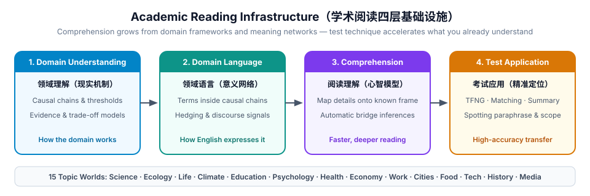

## Topic Worlds in Academic Reading（学术阅读中的主题世界）

Academic reading draws its passages from a limited set of recurring domain worlds（领域世界）: science, environment, life, climate, education, psychology, health, economy, work, cities, agriculture, technology, history, media, design, and culture. These topic worlds appear across examinations, textbooks, university courses, and public discourse because they represent the domains where educated societies think, investigate, debate, and make decisions. Their recurrence creates a stable landscape（稳定景观）that a prepared reader can learn to navigate.

Each topic world carries its own conceptual structure（概念结构）— a set of core ideas that shapes what the domain notices, investigates, and explains. In ecology, these core ideas include system（系统）, function（功能）, biodiversity（生物多样性）, resilience（韧性）, disturbance（扰动）, and adaptation（适应）. In economics, they include scarcity（稀缺性）, incentive（激励）, market（市场）, productivity（生产率）, and distribution（分配）. In psychology, they include perception（感知）, attention（注意力）, memory（记忆）, emotion（情绪）, bias（偏见）, and behaviour（行为）. These ideas form networks of relationships, and those networks define how each domain constructs explanations.

A text about coral reef decline enters the domain of ecology. It traces how rising sea temperature（海水温度）causes coral bleaching（珊瑚白化）, how bleaching weakens the habitat structure（栖息地结构）that reef fish depend on, how biodiversity loss（生物多样性丧失）reduces the reef's capacity to recover from further disturbance, and how human activity — overfishing（过度捕捞）, coastal development（沿海开发）, nutrient runoff（养分径流）— compounds the pressure at every stage. The argument moves through ecological relationships: cause, effect, interaction, threshold, and recovery. A reader who already holds the ecological framework follows this argument readily because the conceptual structure is familiar.

A text about urban housing enters the domain of urban studies（城市研究）. It traces how population density（人口密度）drives land demand（土地需求）, how rising land prices increase housing costs（住房成本）, how high living costs push residents farther from employment centres（就业中心）, how longer commuting time（通勤时间）reduces personal time and increases transport demand（交通需求）, and how infrastructure（基础设施）either absorbs or buckles under growing pressure. The argument moves through spatial and economic relationships: concentration, demand, cost, displacement, and capacity. A reader who understands how cities organise space, population, and services recognises this logic immediately.

A text about drug trials（药物试验）enters the domain of health science. It traces how researchers design randomised controlled trials（随机对照试验）, how control groups（对照组）isolate the effect of a treatment（处理）, how sample size（样本量）affects the reliability of findings（研究发现）, how statistical significance（统计显著性）indicates whether an observed difference is unlikely under a chance model（随机模型）, and how cautious language（谨慎表达）marks the boundary between association（关联）and causation（因果关系）. The argument moves through evidence relationships: design, measurement, comparison, probability, and conclusion.

Across these examples, a consistent pattern emerges: each domain organises its material around a small number of core relationships. Ecological texts move through system-function-disturbance-recovery relationships. Economic texts move through scarcity-choice-incentive-outcome relationships. Scientific texts move through observation-hypothesis-evidence-conclusion relationships. Psychological texts move through stimulus-perception-interpretation-behaviour relationships. Historical texts move through evidence-interpretation-revision relationships. Recognising these relationship patterns allows the reader to anticipate the structure of a new text before reading it in detail.

Topic worlds recur across academic reading because they address fundamental questions about how the natural world operates, how human societies function, and how individuals think and behave. University study in almost any discipline requires reading texts from these domains. An engineering student reads about environmental impact assessment（环境影响评估）. A business student reads about consumer psychology（消费者心理）and market competition（市场竞争）. A medical student reads about public health policy（公共健康政策）and resource allocation（资源分配）. A law student reads about environmental regulation（环境法规）and economic evidence. The same domain worlds appear because the same fundamental questions persist across disciplines.

Building domain knowledge systematically improves reading ability at a structural level. Each domain learned provides a conceptual framework（概念框架）that makes new texts in that domain more intelligible. A reader who understands how ecologists think about forests follows a new text on forest management（森林管理）, deforestation（森林砍伐）, or conservation（保护）with ease because the conceptual framework — system, function, biodiversity, resilience, disturbance, recovery — already organises how the material is presented. The text adds new details onto an existing structure rather than requiring the reader to build that structure from scratch.

This process is cumulative（累积的）. As the reader learns more domains, the frameworks begin to connect. Ecological resilience and economic risk share the concept of system vulnerability（系统脆弱性）. Psychological bias and economic decision-making share the concept of bounded rationality（有限理性）. Public health and environmental science share the concept of risk factor（风险因素）. Each cross-domain connection（跨领域连接）makes the next domain easier to enter because the reader already holds conceptual structures that partially overlap with the new material. Domain knowledge therefore grows faster as it grows wider.

## Domain Language as a System of Understanding（作为理解系统的领域语言）

Domain language（领域语言）functions as the system of expression through which a community of researchers, practitioners, and writers describes the objects, relationships, processes, problems, and findings in its field. It operates as a perception framework（感知框架）that directs readers toward what matters in a domain, how things connect, what counts as evidence, and what questions deserve investigation. Domain language grows from the domain's way of organising reality — it is inseparable from the conceptual structure it expresses.

In the domain of health, the phrase risk factor（风险因素）activates a specific model of cause and prevention: certain behaviours or conditions increase the probability（概率）of negative health outcomes, and public health intervention（公共健康干预）can reduce risk by modifying those factors. When a text uses "risk factor," it calls into play an entire network of connected concepts — relative risk（相对风险）, odds ratio（比值比）, confounding variable（混杂变量）, prevention（预防）, intervention（干预）, population-level evidence（群体层面证据）— that together describe how health researchers think about causation and prevention. The term signals the causal model that organises the discussion, going well beyond naming a single concept.

In economics, productivity（生产率）captures the relationship between input（投入）and output（产出）: how much output can be produced from a given amount of labour, capital, or resources. Higher productivity generates more output per unit of input, driving economic growth（经济增长）and rising living standards（生活水平）. When a text reports that "productivity increased," it signals that more output is being produced from the same inputs — a change traceable to better technology（技术改进）, improved skills（技能提升）, more efficient organisation（更高效的组织）, or economies of scale（规模经济）. The term connects forward to wages（工资）, profits（利润）, competitiveness（竞争力）, innovation（创新）, and living standards, forming a conceptual chain that organises how economists analyse progress and efficiency.

In ecology, resilience（韧性）captures the capacity of an ecosystem to absorb disturbance（吸收扰动）and continue functioning（继续运行）. The term reaches outward to biodiversity（生物多样性）, which provides alternative pathways（替代路径）inside the system; to threshold（阈值）, which marks the limit beyond which recovery fails; to functional redundancy（功能冗余）, which allows multiple species to perform the same ecological role; and to disturbance regime（扰动机制）, which describes the type, frequency, and intensity of shocks the system faces. When a text uses "resilience," it activates this entire network, and the reader who holds the network follows the argument at a deeper level.

Domain language operates at multiple levels simultaneously. At the word level（词汇层面）, terms carry domain-specific meanings shaped by the conceptual network they belong to. "Stress" in psychology connects to anxiety（焦虑）, coping（应对）, emotion regulation（情绪调节）, and mental health（心理健康）. "Stress" in materials science connects to force（力）, strain（应变）, deformation（变形）, and fracture（断裂）. "Culture" in biology refers to growing organisms in a controlled environment; in anthropology it refers to shared beliefs, practices, and symbolic systems（共享信仰、实践和符号系统）. The domain context activates the correct meaning, and understanding the domain resolves the ambiguity automatically.

At the phrase level（短语层面）, domain language includes recurring patterns of expression that carry methodological assumptions（方法论假设）. In scientific writing, "these findings suggest that..." signals a tentative conclusion（试探性结论）supported by evidence but open to revision. "Further research is needed" signals that the current evidence remains insufficient for a firm conclusion. "The results are consistent with..." signals that the data align with the hypothesis while leaving room for alternative explanations. In economic writing, "ceteris paribus" (all else being equal / 其他条件不变) signals that the analysis isolates one variable while holding other factors constant. These phrases encode how each domain evaluates evidence and draws conclusions.

At the discourse level（话语层面）, domain language includes characteristic argument structures（特征性论证结构）that organise how texts present information. A scientific paper typically moves from observation（观察）to hypothesis（假设）to evidence（证据）to conclusion（结论）. A policy analysis typically moves from problem（问题）to cause（原因）to solution（方案）to implementation（实施）. A historical argument typically moves from evidence（证据）to interpretation（解释）to significance（意义）. An economic analysis typically moves from scarcity condition（稀缺条件）to incentive structure（激励结构）to behavioural response（行为反应）to outcome（结果）. Recognising these discourse patterns allows the reader to anticipate what comes next and to locate specific claims within the larger argument.

Domain language also encodes evidence standards（证据标准）. In medicine, a randomised controlled trial（随机对照试验）provides stronger evidence for causation than an observational study（观察性研究）. A systematic review（系统综述）that combines results from multiple studies provides stronger evidence than any single study. In ecology, long-term field data（长期野外数据）across multiple sites provides stronger evidence for population trends than a single-season survey. In economics, natural experiments（自然实验）that exploit exogenous variation（外生变异）provide stronger evidence for causal claims than simple correlations. Domain language signals these evidence hierarchies（证据层级）through verb choice, study description, and qualification patterns.

Domain language and domain understanding grow together in a productive cycle（生产性循环）. Understanding the domain helps the reader grasp the language because each term refers to a known relationship. Understanding the language deepens domain understanding because each term carries assumptions about how the domain works. Building one strengthens the other simultaneously, creating a foundation that makes each new text in the domain more accessible than the last.

::: {.content-visible when-format="html"}

:::

## Meaning Networks: From Words to Systems（意义网络：从单词到系统）

Words in any domain connect to other words through meaning networks（意义网络）— structured systems of relationships that give each term its full explanatory power. A dictionary may define "resilience" as "the ability to recover quickly," but the domain meaning of resilience in ecology requires connecting it to the entire system of related concepts that determine how resilience operates in the real world.

Ecological resilience depends on biodiversity（生物多样性）, which provides functional redundancy（功能冗余）inside the system. When one species declines, other species performing similar ecological roles maintain the system's function. Resilience also depends on the disturbance regime（扰动机制）— the type, frequency, and intensity of shocks the system faces. A system adapted to frequent low-intensity fire may collapse under a single high-intensity fire that exceeds its evolutionary experience. Resilience has a threshold（阈值）: the point beyond which the system shifts into an alternative stable state（替代稳定状态）— a different configuration with different species, different processes, and different functions. Each of these concepts — biodiversity, functional redundancy, disturbance regime, threshold, alternative stable state — forms part of the meaning network that gives "resilience" its full domain significance.

These meaning networks reflect the causal structure（因果结构）of the domain. In ecology, biodiversity genuinely provides resilience because different species respond differently to disturbances — some tolerate drought, some resist disease, some recover quickly from fire. The meaning network mirrors the causal network（因果网络）: the relationships between concepts reflect the relationships between real-world factors. Learning the language therefore means learning the causal structure that the language describes.

The meaning network around soil quality（土壤质量）in agricultural science illustrates this principle further. Soil quality depends on soil texture（土壤质地）— the proportion of sand, silt, and clay — which determines water retention（水分保持）and drainage（排水）. It depends on organic matter content（有机质含量）, which improves structure, increases nutrient availability（养分有效性）, and supports soil organisms（土壤生物）. It depends on soil pH（土壤酸碱度）, which controls nutrient solubility（养分溶解度）and microbial activity（微生物活性）. It connects forward to crop yield（作物产量）, irrigation（灌溉）, fertiliser application（施肥）, erosion（侵蚀）, and long-term land productivity（土地生产力）. Each term in this network refers to a real factor that interacts with other factors in the soil system. A reader who holds this network follows a text about soil degradation（土壤退化）readily because the causal relationships are already understood.

The same word can carry different meanings across domains because it belongs to different meaning networks. "Adaptation" in evolutionary biology（进化生物学）connects to natural selection（自然选择）, genetic variation（遗传变异）, environmental pressure（环境压力）, fitness（适应度）, and survival（生存）. "Adaptation" in climate policy（气候政策）connects to vulnerability（脆弱性）, exposure（暴露）, infrastructure modification（基础设施改造）, and risk reduction（风险降低）. "Adaptation" in psychology connects to habituation（习惯化）, coping strategy（应对策略）, and behavioural adjustment（行为调整）. The domain context activates the correct meaning network, and the network resolves the meaning automatically.

Meaning networks explain why isolated vocabulary learning produces limited results. Memorising a definition of "resilience" as "ability to recover" leaves the connections — to biodiversity, disturbance, threshold, functional redundancy, alternative stable state — unbuilt. A reader who holds only the definition may recognise the word yet struggle to follow the argument that depends on the network. A reader who holds the network understands what the text is saying because the relationships are already part of their conceptual structure.

Meaning networks also explain why domain knowledge transfers across texts. A reader who understands the ecological meaning network — system, function, biodiversity, resilience, disturbance, threshold, recovery — follows a text about coral reefs, forests, grasslands, or wetlands with equal ease because the same conceptual structure organises all of them. The specific species, locations, and conditions differ, but the relationships — how biodiversity supports resilience, how disturbance tests system function, how thresholds mark recovery limits — remain the same across ecosystems. The meaning network provides a general framework that applies to many specific cases.

Building meaning networks requires encountering terms inside the relationships they describe. When a text explains how deforestation（森林砍伐）reduces canopy cover（树冠覆盖）, exposes soil to erosion, removes habitat structure, and changes the local water cycle（局部水循环）, the reader encounters "canopy cover," "erosion," "habitat," and "water cycle" inside the causal chain that connects them. Each term gains meaning from its position in the chain — canopy cover prevents erosion, erosion removes soil, soil loss reduces vegetation, vegetation loss changes water movement. The network builds through mechanism（机制）, growing stronger with each causal connection the reader absorbs.

This book builds meaning networks one domain at a time. Each chapter opens a topic world, explains how the core concepts connect, and introduces the English expressions where they naturally live — inside the mechanisms, relationships, and processes that give them meaning. When the reader encounters these expressions in a real academic text, recognition is immediate because the meaning network is already established. The words make sense because the relationships they describe are already understood.

## Domain Understanding and Reading Comprehension（领域理解与阅读理解）

Reading comprehension（阅读理解）proceeds by building a mental model（心智模型）of what a text describes. The reader constructs a representation of the situation, events, mechanisms, or concepts the text discusses, alongside a representation of the argument the text makes. This process depends heavily on existing domain knowledge — the conceptual frameworks, meaning networks, and causal models that the reader already holds.

A reader with domain knowledge approaches a text with an existing mental model（已有心智模型）that new information maps onto directly. When a text about climate change discusses how rising carbon emissions（碳排放）increase atmospheric greenhouse gas concentration（温室气体浓度）, which raises global average temperature（全球平均温度）, which alters precipitation patterns（降水模式）and increases extreme weather frequency（极端天气频率）, the reader who already understands the climate system integrates each new detail into the existing framework. The causal chain — emissions, concentration, temperature, precipitation, extreme weather — already lives in the reader's conceptual structure, so the text adds specific data, new evidence, or updated projections onto a known scaffold.

A reader without domain knowledge faces a different task: building the mental model from scratch while reading. Each new concept — greenhouse effect（温室效应）, radiative forcing（辐射强迫）, feedback mechanism（反馈机制）, climate sensitivity（气候敏感度）— must be understood individually and connected to other concepts in real time. This dual task — learning the domain structure while following the specific argument — consumes cognitive resources（认知资源）and slows comprehension. The reader may understand each sentence in isolation yet fail to build the integrated model that connects them.

Academic reading questions typically ask about relationships between ideas: What causes X? What effect does Y have on Z? How does A influence B? What conclusion follows from the evidence? These questions test the reader's ability to identify and understand causal, comparative, and explanatory relationships within the domain. A reader who already knows how causes, effects, and explanations work in that domain focuses on the specific claims the text makes. A reader encountering an unfamiliar domain must first understand the basic relationships before evaluating the specific argument.

Consider two readers approaching a text about antibiotic resistance（抗生素耐药性）. The first reader already understands that bacteria（细菌）reproduce rapidly, that genetic mutation（基因突变）occurs during reproduction, that some mutations confer resistance to antibiotics, that antibiotic use（抗生素使用）creates selection pressure（选择压力）favouring resistant strains（耐药菌株）, and that overuse of antibiotics accelerates this evolutionary process. This reader follows the text's specific argument — perhaps about hospital prescribing practices（医院处方行为）or agricultural antibiotic use — because the underlying mechanism is already understood. The second reader, unfamiliar with evolution and microbial biology, must learn the basic mechanism from the text while also following the specific policy or medical argument — a substantially harder task.

Domain knowledge provides a search framework（搜索框架）that makes information location more efficient. A reader who understands the domain knows where to look for specific types of information. In a scientific text, the hypothesis appears early, methods describe how evidence was collected, results present the data, and the discussion interprets the findings. In an economic analysis, the problem statement defines the scarcity condition, the analysis section traces incentive-behaviour-outcome relationships, and the conclusion draws policy implications. This structural knowledge（结构知识）allows the reader to locate relevant information quickly and to understand each part in relation to the whole.

Domain knowledge also improves inference generation（推理生成）. Academic texts leave many connections unstated, assuming the reader can fill in intermediate steps. A text about deforestation may state that "tree removal increased sediment load（泥沙负荷）in downstream rivers" without explaining the intermediate steps: roots no longer stabilise soil, exposed soil erodes under rainfall, eroded sediment enters waterways, increased sediment load affects aquatic habitats and water quality. A reader who understands the ecological mechanism generates these inferences automatically. A reader who lacks this knowledge encounters a gap between what the text states and what it assumes.

Comprehension speed（理解速度）increases with domain familiarity because the reader processes known relationships more efficiently. A reader who understands how markets respond to price signals（价格信号）reads an economics text about supply disruption（供给中断）and price adjustment（价格调整）rapidly, because the mechanism — reduced supply raises price, higher price reduces demand and attracts alternative supply — is already automated in their conceptual structure. The reader processes the specific details of the case rather than struggling to understand the basic mechanism. This efficiency compounds across long texts and multiple passages.

Domain understanding and reading comprehension form a reinforcing cycle（增强循环）. Domain knowledge improves comprehension. Better comprehension allows the reader to learn more from each text. More learning deepens domain knowledge. Deeper domain knowledge makes the next text easier to understand. This cycle explains why reading ability is partly domain-specific: a person who reads scientific texts fluently may struggle with historical analysis, and a person who reads economic arguments easily may find psychological research unfamiliar. Reading ability grows domain by domain, framework by framework — each new domain adding to the reader's capacity to understand the next.

## Domain Foundation as Reading Infrastructure（领域基础作为阅读基础设施）

Domain understanding（领域理解）and domain language（领域语言）together form the reading infrastructure（阅读基础设施）that makes academic comprehension possible. This infrastructure has two interdependent layers. The first layer is domain understanding: how the domain works, what problems it studies, how factors interact, what counts as evidence, what kinds of explanations are accepted, and how arguments are structured. The second layer is domain language: the words and phrases that express the key concepts, mechanisms, relationships, and argument structures of the domain. These two layers reinforce each other — understanding the domain gives meaning to the language, and understanding the language deepens access to the domain.

Reading infrastructure determines how efficiently a reader processes new texts. When the infrastructure is in place, the reader approaches a text with an existing conceptual framework that organises incoming information. New details are mapped onto known structures. New evidence is evaluated against known standards. New arguments are followed through known discourse patterns. The reader spends cognitive resources on the specific content of the text rather than on building basic understanding from scratch.

When the infrastructure is still developing, every text requires ground-up construction. The reader must learn the domain concepts, understand their relationships, grasp the evidence standards, and follow the argument structure — all while reading the specific passage. This ground-up construction is slow, effortful, and error-prone. The reader may understand individual sentences yet miss the larger logic that connects them, or identify facts while the causal relationships that give facts significance remain invisible.

Question-solving technique（解题技巧）— skimming（略读）, scanning（扫读）, identifying question types（识别题型）, eliminating incorrect options（排除错误选项）— operates on top of the reading infrastructure. These techniques help locate information and manage time, yet they function best when comprehension is already present. A reader may find the correct paragraph through scanning yet still fail to understand what the paragraph says if the domain is unfamiliar. Skimming identifies the location of relevant information; comprehension requires understanding the information once located.

The distinction between technique and comprehension becomes clear when considering how readers handle unfamiliar domains. A reader with strong technique but weak domain knowledge locates information efficiently yet struggles to evaluate its meaning, assess its significance, or connect it to other ideas in the text. A reader with strong domain knowledge but less technique may read more slowly yet understands what they read, generates correct inferences, and builds an accurate mental model of the text's argument. Technique improves performance when comprehension is already present; domain knowledge creates the comprehension that technique then accelerates.

Comprehension research confirms that reading ability is substantially domain-specific. A person who reads scientific texts fluently may struggle with legal analysis. A person who understands economic arguments may find anthropological writing opaque. Comprehension depends on the conceptual frameworks the reader brings to the text, and these frameworks are domain-specific — built through exposure to the domain's content, language, and argument structures over time.

This book builds reading infrastructure domain by domain. Each chapter opens a topic world, explains how the core mechanisms work, introduces the language that expresses those mechanisms, and develops the meaning networks that connect concepts into coherent frameworks. The writing follows the style of academic texts — English-first exposition with Chinese brackets for key concepts — so that the reader builds comprehension in the same language environment they will encounter in actual reading.

A reader who completes this book approaches academic texts with established conceptual frameworks across the most common topic worlds. The domain is understood, so the reader focuses on what the text says rather than struggling to grasp what the text is about. The language is familiar, so the reader follows arguments through their full causal chains without pausing to decode individual terms. The meaning networks are in place, so each new text strengthens existing knowledge rather than requiring new construction. Domain infrastructure, once built, transforms reading from an effortful decoding process into an act of understanding.

::: {.content-visible when-format="html"}

:::

