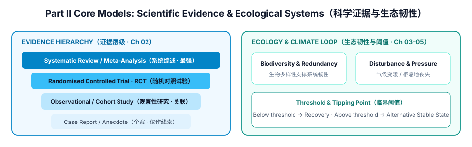

## Observation as the Beginning of Inquiry（观察作为探究起点）

Observation（观察）begins when a pattern in the world becomes stable enough to deserve explanation. Some coral reefs（珊瑚礁）bleach under rising sea temperature while nearby reefs in apparently similar conditions remain healthy. Children who spend more time in outdoor green spaces（户外绿色空间）show measurably better attention（注意力）in classroom settings. Certain agricultural soils produce consistently higher crop yields（作物产量）with the same fertiliser and water input. Soil erosion（土壤侵蚀）accelerates on slopes where vegetation has been removed but remains minimal under intact forest canopy（森林树冠）. These contrasts — between conditions where a phenomenon appears and conditions where it does not — form the raw material of scientific inquiry（科学探究）.

A structured contrast（结构化对比）gives observation a direction and turns an isolated event into an object of inquiry. The contrast generates the research question（研究问题）: Why the difference? What mechanism produces the pattern? Under what conditions does the pattern hold, and under what conditions does it break down? Repeated occurrence（重复出现）stabilises the contrast — a single event may reflect coincidence, but a pattern that appears consistently across time, places, samples, or populations demands explanation and becomes the starting point for systematic investigation.

Pattern recognition（模式识别）extends the brain's natural capacity to detect regularities. The human brain registers seasonal changes in temperature, daily rhythms in animal activity, and spatial clustering of plant species. Scientific observation formalises this capacity through systematic recording（系统记录）, standardised measurement（标准化测量）, and repeated sampling（重复取样）. These practices separate genuine patterns from random fluctuations（随机波动）. A farmer may notice that one field produces better crops than another. A soil scientist records soil pH（土壤酸碱度）, organic matter content（有机质含量）, nutrient levels（养分水平）, moisture retention（水分保持）, and microbial activity（微生物活性）across multiple sampling points in both fields over several growing seasons. Systematic observation transforms a local impression into comparable data that can be analysed, questioned, and combined with evidence from other locations.

The distinction between signal（信号）and noise（噪音）organises this transformation. A signal carries information about how a system operates — a consistent pattern that repeats across observations. Noise is random variation that obscures the signal — measurement error（测量误差）, individual differences（个体差异）, environmental fluctuations（环境波动）, and uncontrolled factors that create scatter in the data. Repeated observation（重复观察）separates the two: a pattern that appears consistently across many observations, across different samples, and under varying conditions is more likely to represent a real feature of the system. A single coral bleaching event may reflect a local temperature anomaly; bleaching observed across multiple reef systems over consecutive warm seasons indicates a systematic relationship between ocean temperature（海洋温度）and coral health（珊瑚健康）.

Measurement（测量）makes observations comparable across time, places, samples, and researchers. It converts qualitative impressions（定性印象）into quantitative data（定量数据）that can be checked, repeated, aggregated, and combined with other evidence. "Coral bleaching is 40 percent more prevalent in reef zones where water temperature exceeds 29°C" gives inquiry a precise starting point — the relationship is quantified, the conditions are specified, and the observation can be verified by other researchers at other reefs. Quantified observations direct systematic investigation by establishing what to compare, where to look, and how to judge whether a pattern persists.

A baseline（基准状态）provides the reference point that gives measurement its interpretive force. If a researcher observes that a bird population in a forest fragment has declined to 200 individuals, the observation gains meaning when compared with a baseline — the population size recorded in previous decades, the population in a similar undisturbed forest, or the population predicted by habitat area（栖息地面积）and species-area relationships（物种-面积关系）. The baseline establishes what is normal, expected, or stable within the system, so that deviations（偏差）can be detected, measured, and investigated. Climate scientists compare current atmospheric CO₂ concentration（大气二氧化碳浓度）with ice core records（冰芯记录）spanning hundreds of thousands of years; the baseline reveals how far current levels depart from historical variation and whether the departure exceeds the range of natural fluctuation.

Instruments（仪器）extend observation by making small, distant, fast, slow, or invisible changes available to human analysis. A thermometer measures temperature that skin cannot reliably judge across days and seasons. A microscope reveals cellular structures（细胞结构）and microorganisms（微生物）too small for the naked eye. Satellite sensors（卫星传感器）detect changes in vegetation cover（植被覆盖）, sea surface temperature, and ice extent across thousands of square kilometres over decades. DNA sequencing（DNA测序）reveals genetic relationships（遗传关系）invisible to morphological observation（形态观察）. Each instrument transforms a physical property into a measurable signal, extending the range, precision, and scope of what can be observed. Each instrument also introduces potential sources of error — calibration drift（校准漂移）, measurement bias（测量偏差）, limited resolution（分辨率限制）, and systematic distortion（系统偏差）— that researchers must identify, quantify, and account for in their analysis.

An anomaly（异常现象）emerges when an observation departs from the expected pattern and reveals the limits of existing explanations. Anomalies redirect inquiry toward mechanisms that current theories do not predict. When an experiment produces an unexpected result, that result becomes an observation requiring a new explanation. Penicillin was discovered because Alexander Fleming noticed that a mould contaminant had killed bacteria in a discarded culture dish — an anomaly that opened the field of antibiotic medicine（抗生素医学）. The ozone hole（臭氧层空洞）was detected when satellite measurements showed Antarctic ozone depletion（臭氧消耗）far beyond what atmospheric models predicted. Each anomaly became the starting point for a new line of inquiry that revised existing understanding.

Observations arise from different settings that shape what can be seen and what remains hidden. Field observation（野外观察）takes place in natural environments where conditions are complex, variable, and uncontrolled by the researcher. It captures how systems operate under real-world conditions — how predator-prey relationships（捕食者-猎物关系）function in a living ecosystem, how soil erosion responds to actual rainfall patterns, how animal behaviour（动物行为）changes across seasons and habitats. Laboratory observation（实验室观察）takes place in controlled environments where the researcher can isolate specific factors, standardise conditions, and measure outcomes with greater precision. Each setting reveals different aspects of the phenomenon, and the strongest inferences emerge when field and laboratory observations converge on the same pattern.

Observation therefore functions as the first disciplined movement from the world to explanation. It selects a pattern, stabilises it through repeated recording, measures it against a baseline, separates signal from noise, extends its range through instruments, and turns anomaly into a new research question. The vocabulary that grows from this process — pattern, contrast, baseline, signal, noise, anomaly, measurement, instrument — names the tools through which scientists detect, record, and refine the phenomena they seek to explain. Every subsequent stage of inquiry begins from the quality and structure of the initial observation.

## Hypotheses and Testable Explanations（假设与可验证解释）

A hypothesis（假设）turns an observed pattern into a testable explanation（可验证解释）. It proposes a mechanism（被提出的机制）that connects one condition with one possible outcome, and it generates a prediction（预测）: if the proposed mechanism is real, a similar pattern should appear under similar conditions, and the pattern should weaken, disappear, or change when the condition changes. A hypothesis transforms a descriptive observation — "coral bleaching is more common in warmer water" — into a causal proposal（因果提案）— "elevated water temperature disrupts the symbiotic relationship（共生关系）between coral polyps（珊瑚虫）and their zooxanthellae（虫黄藻）, causing the coral to lose its colour and its primary energy source."

Testability（可验证性）gives a hypothesis its scientific force. A hypothesis must generate a specific prediction that can be compared with empirical evidence（经验证据）. The hypothesis that greenhouse gas emissions（温室气体排放）drive global temperature rise predicts that increasing atmospheric CO₂ concentration will be followed by rising average surface temperature（地表平均温度）, that the warming pattern will be consistent with greenhouse forcing（温室效应强迫）rather than solar variation（太阳辐射变化）, and that the stratosphere（平流层）will cool while the troposphere（对流层）warms. Each prediction can be checked against temperature records（温度记录）, ice core data（冰芯数据）, satellite measurements（卫星测量）, and climate models（气候模型）. When the data match the predictions, the hypothesis gains support. When they diverge, the hypothesis must be revised or abandoned.

Falsifiability（可证伪性）marks the boundary between scientific explanation and untestable claim. A hypothesis is falsifiable when evidence can be imagined that would show it to be false. The statement "All swans are white" is falsifiable because a single black swan disproves it. The statement "Some outcomes are influenced by undetectable forces" generates no specific prediction and therefore remains outside the reach of empirical testing. Science progresses by building explanations that can be challenged, refined, or eliminated by evidence — explanations that risk being wrong in order to have the chance of being right.

Researchers develop competing hypotheses（竞争性假设）— multiple possible explanations for the same observation — and design tests to distinguish among them. When coral bleaching could be caused by elevated temperature, chemical pollution（化学污染）, increased ultraviolet radiation（紫外线辐射）, or pathogen exposure（病原体暴露）, each hypothesis generates different predictions about where, when, and how bleaching should appear. Temperature-driven bleaching predicts that bleaching events will coincide with warm-water episodes and will affect shallow reefs more than deep reefs. Pollution-driven bleaching predicts that bleaching will correlate with proximity to pollution sources（污染源）regardless of temperature. Data from multiple reefs across different conditions allow researchers to evaluate which explanation fits the observed pattern most completely. A hypothesis that survives repeated attempts to falsify it gains credibility through the systematic elimination of alternative explanations（替代解释）.

Confounding variables（混杂变量）represent a persistent challenge in hypothesis testing. A confounding variable influences both the proposed cause and the observed outcome, creating an apparent relationship that may be spurious（虚假的）. If a study finds that children who attend preschool（学前教育）show higher academic achievement（学业成就）than children who do not, family socioeconomic status（家庭社会经济地位）may confound the relationship — higher-income families are more likely to send children to preschool and also more likely to provide educational resources（教育资源）at home. A well-constructed hypothesis anticipates possible confounding variables and predicts what would be observed if they were controlled. The hypothesis gains strength when the predicted relationship persists after confounding factors are measured and accounted for statistically（统计控制）.

A hypothesis produces useful knowledge even when evidence contradicts it. A rejected hypothesis eliminates one possible explanation and directs attention toward alternatives. Early hypotheses proposed that peptic ulcers（消化性溃疡）were caused by stress and diet, and treatment focused on managing those factors. When Barry Marshall and Robin Warren proposed that Helicobacter pylori bacteria caused most ulcers, the hypothesis faced initial rejection. Evidence accumulated — the bacteria were found in ulcer patients, antibiotic treatment（抗生素治疗）healed ulcers, and experimental infection produced gastritis（胃炎）— until the bacterial hypothesis replaced the stress hypothesis. Testing the earlier hypothesis narrowed the search toward the correct mechanism.

Hypotheses are revised（修正）as new evidence accumulates. A hypothesis that initially seems promising may be modified to account for observations that do not fit the original formulation. The original hypothesis that ozone depletion（臭氧消耗）was caused by chlorofluorocarbons（氯氟烃）was revised as evidence showed that polar stratospheric clouds（极地平流层云）and spring sunlight accelerated the chemical reactions（化学反应）that destroyed ozone. The revised hypothesis explained why depletion was most severe over Antarctica and why it followed a seasonal pattern. Revision through evidence refines explanations over time, making them more accurate, more specific, and more complete.

The process of hypothesis formation connects observation to explanation through a chain of reasoning: a pattern in the world suggests a mechanism, the mechanism generates a prediction, the prediction is tested against evidence, and the evidence either supports, weakens, or overturns the proposed explanation. Each link in this chain — mechanism, prediction, falsifiability, competing hypotheses, confounding variable, revision — names a step through which scientists construct, test, and refine their understanding of observed patterns.

## Experiments, Variables, and Control（实验、变量与控制）

An experiment（实验）simplifies complex reality into a controlled comparison（受控比较）so that researchers can examine whether changing one factor produces changes in an outcome. By isolating one relationship from the many that operate simultaneously in the natural world, the experiment creates conditions in which a causal connection can be observed directly.

The independent variable（自变量）is the part of the situation that researchers deliberately change in order to create a testable difference. The dependent variable（因变量）is the outcome measured to detect whether that change produces an effect. The experiment tests whether systematic changes in the independent variable produce systematic changes in the dependent variable. A researcher testing whether nitrogen fertiliser（氮肥）application affects wheat yield（小麦产量）sets fertiliser amount as the independent variable and grain yield per hectare（每公顷产量）as the dependent variable. All other factors — soil type（土壤类型）, irrigation（灌溉）, seed variety（种子品种）, planting density（种植密度）, sunlight exposure（光照暴露）— are held constant across treatment groups. If wheat receiving higher nitrogen application produces consistently higher yield across replicated plots（重复小区）, the result supports the hypothesis that nitrogen availability（氮有效性）limits grain production under these conditions.

Controlled variables（控制变量）are the factors held constant to prevent them from distorting the relationship under investigation. Each controlled variable represents a potential confounding variable（混杂变量）— a factor that could affect the dependent variable independently and therefore obscure or mimic the effect of the independent variable. If the researcher does not control soil quality across experimental plots, differences in soil organic matter（土壤有机质）or pH could cause yield differences that are mistakenly attributed to fertiliser. Good experimental design（实验设计）identifies the most important potential confounding variables before the experiment begins and builds controls to neutralise their influence.

A control group（对照组）provides the reference condition against which the treatment effect is measured. The control group does not receive the treatment（处理）— the systematic change in the independent variable — while the experimental group（实验组）does. Any difference in outcome between the groups can be attributed to the treatment, provided that all other conditions were equivalent. In a drug trial（药物试验）testing a new antihypertensive medication（降压药物）, the control group receives a placebo（安慰剂）— a substance identical in appearance but containing no active drug — while the experimental group receives the actual medication. If the experimental group shows a greater reduction in blood pressure（血压）than the control group, the difference supports the hypothesis that the drug causes the improvement.

The placebo effect（安慰剂效应）creates the need for control groups in medical and behavioural research. Patients often improve simply because they believe they are receiving treatment, even when the treatment contains no active ingredient. The expectation of improvement（改善预期）can activate physiological responses — endorphin release（内啡肽释放）, stress reduction（压力减轻）, immune modulation（免疫调节）— that produce real changes in symptoms. A placebo control group measures the magnitude of this effect, allowing the researcher to isolate the drug's specific pharmacological effect（药理效应）beyond any psychological or contextual influence.

Random assignment（随机分配）of participants to control and experimental groups strengthens causal inference（因果推断）. When participants are randomly assigned, the groups are likely to be similar in all characteristics that might affect the outcome — age, sex, baseline health（基线健康）, socioeconomic status（社会经济地位）, genetic predisposition（遗传易感性）, and any unmeasured factors that could influence the dependent variable. Random assignment distributes these potential confounders（潜在混杂因素）approximately equally across groups, so that any post-treatment difference in outcome can be attributed to the treatment with greater confidence. This procedure defines the randomised controlled trial（随机对照试验）, which provides the strongest evidence for causal claims in medical, educational, and social research.

Blinding（盲法）further reduces bias in experimental results. In a single-blind study（单盲研究）, participants do not know whether they are receiving the treatment or the placebo, preventing their expectations from influencing outcomes. In a double-blind study（双盲研究）, neither the participants nor the researchers who interact with them know which group receives which condition, preventing researcher expectations（研究者预期）from influencing data collection, measurement, or interpretation. Blinding ensures that the observed differences reflect the treatment itself rather than the beliefs or behaviours of the people involved.

Experimental design involves deliberate choices about sample size（样本量）, measurement procedures（测量程序）, control conditions（控制条件）, treatment levels（处理水平）, and data collection methods（数据收集方法）. A well-designed experiment anticipates potential sources of error（误差来源）and builds safeguards against them. Sample size must be large enough to detect a meaningful effect if one exists — a study with too few participants may fail to detect a real treatment effect simply because random variation（随机变异）swamps the signal. Measurement procedures must be standardised（标准化）so that all participants are assessed in the same way.

The relationship between controlled settings（受控环境）and real-world complexity（真实世界复杂性）creates a fundamental tension in experimental research. Laboratory experiments achieve high internal validity（内部效度）— confidence that the observed effect was caused by the manipulated variable — by controlling extraneous factors. This control may reduce external validity（外部效度）— the extent to which findings generalise（推广）to natural settings where multiple factors interact simultaneously. A drug that works in a controlled trial with carefully selected participants may produce different results in general clinical practice（临床实践）where patients have multiple conditions, take other medications, and vary in adherence（依从性）. Researchers address this tension by conducting field experiments（野外实验）, replication studies（重复研究）, and systematic reviews（系统综述）that test whether laboratory findings hold under more complex conditions.

Experimental language grows from the need to make causation visible. Terms such as independent variable, control group, placebo, random assignment, and internal validity name the design choices that allow researchers to separate a causal relationship from the complexity surrounding it. Through these choices, an experiment transforms a hypothesis into a concrete test that produces data capable of supporting, weakening, or refining a proposed explanation.

::: {.content-visible when-format="html"}

:::

## Data, Evidence, and Findings（数据、证据与发现）

Experiments and observations produce data（数据）: measurements, records, and observations that capture what occurred during the study. Raw data（原始数据）are the direct outputs of measurement — numerical readings from instruments, images from microscopes or satellites, recordings from behavioural observations, survey responses（调查问卷回答）, or biological samples（生物样本）. These raw data must be cleaned（清洗）, coded（编码）, organised, and analysed before they can become evidence. Data cleaning identifies and addresses errors — instrument malfunctions（仪器故障）, recording mistakes（记录错误）, missing values（缺失值）, and outliers（异常值）that may reflect measurement problems rather than genuine phenomena.

Data become evidence（证据）only when they are interpreted in relation to a hypothesis（假设）. A measurement gains evidential force when it supports, weakens, or revises a specific prediction, because evidence is created by the relationship between data and the question being tested. Temperature records from ice cores（冰芯温度记录）constitute evidence for the hypothesis that greenhouse gas concentration（温室气体浓度）drives global temperature when the records show that temperature and CO₂ have moved together over hundreds of thousands of years. The same records constitute evidence against the hypothesis that recent warming is driven solely by natural cycles（自然周期）when they show that current temperatures exceed the range of natural variation observed in the geological record（地质记录）.

Measurement quality（测量质量）determines how much confidence researchers can place in their data. Quality depends on two distinct properties: precision（精确度）and accuracy（准确度）. Precision refers to the consistency of repeated measurements（重复测量的一致性）— a precise instrument produces similar readings when measuring the same quantity multiple times. Accuracy refers to how close a measurement is to the true value（真实值）— an accurate instrument produces readings that reflect the actual quantity being measured. A blood pressure monitor（血压计）that consistently reads 130/85 for a patient whose true blood pressure is 120/80 is precise but inaccurate — the readings are consistent but systematically biased（系统偏差）. A monitor that reads 118/82, then 124/78, then 120/80 for the same patient is accurate on average but imprecise. Both precision and accuracy are necessary for reliable measurement（可靠测量）.

Reliability（可靠性）and validity（有效性）extend the concept of measurement quality to research instruments more broadly — questionnaires（问卷）, behavioural assessments（行为评估）, diagnostic tests（诊断测试）, and observational protocols（观察方案）. Reliability means that the instrument produces consistent results across repeated administrations（重复施测）, different raters（不同评分者）, and different occasions. Validity means that the instrument measures what it claims to measure. A questionnaire designed to measure depression（抑郁）has validity if it actually captures depressive symptoms（抑郁症状）rather than general distress（一般痛苦）or physical illness（身体疾病）. An inconsistent instrument cannot measure anything accurately, and a consistently wrong measurement is reliably wrong — both reliability and validity are required for an instrument to produce trustworthy data.

Sample size（样本量）affects the stability and generalisability（推广性）of evidence. A study with a small sample may produce results that reflect the particular characteristics of those few participants rather than the broader population（更广泛人群）. A clinical trial（临床试验）with 12 participants cannot reliably estimate the average effect of a drug across the diversity of age, sex, genetics, and health conditions in the general population. Larger samples reduce the influence of random variation（随机变异）and produce more stable estimates（更稳定的估计）of effects. Sample size calculations（样本量计算）before a study begins help researchers determine how many participants are needed to detect a meaningful effect with adequate statistical power（统计功效）.

Researchers analyse data using statistical methods（统计方法）to determine whether observed patterns are unlikely to have arisen by chance alone. Statistical significance（统计显著性）means that the observed pattern — a difference between groups, a correlation between variables, a trend over time — would be unlikely under a specified chance model（特定随机模型）, typically a model of no effect or no difference（无效应或无差异模型）. The conventional 5 percent threshold（5%阈值）indicates that the observed result would occur fewer than 5 times in 100 if the null model（零模型）were true. This threshold measures how unusual the observed data would be under a model of no effect; it does not measure the probability that the hypothesis is correct. The meaning of a statistically significant result depends on study design（研究设计）, sample size, measurement quality, and practical effect size（实际效应大小）. A statistically significant result with a tiny effect may have no practical importance（实际重要性）. A result that does not reach statistical significance may still be meaningful if the study had low statistical power（统计功效不足）to detect a real but small effect.

Effect size（效应大小）measures the magnitude（幅度）of the difference or relationship observed. It tells researchers whether an effect exists and how large it is in practical terms. A new teaching method（教学方法）might produce a statistically significant improvement in test scores（考试成绩）, but if the improvement amounts to two points on a 100-point scale, the practical significance（实际意义）for educational outcomes may be minimal. Reporting effect size alongside statistical significance provides a more complete picture — the significance test indicates whether the effect is likely real, and the effect size indicates whether it is large enough to matter.

After analysis, researchers state their findings（研究发现）. Findings answer the original research question: Does the evidence support the hypothesis? What did the study reveal? Findings are stated with appropriate caution（适当谨慎）, recognising the study's limitations（局限性）. Every study has limitations — restricted sample size, measurement constraints, uncontrolled variables, specific population characteristics, or conditions that may not generalise to other settings. Acknowledging limitations demonstrates scientific rigour（科学严谨性）and allows other researchers to design studies that address those limitations.

Scientific confidence grows through replication（可重复性）, convergence（证据汇聚）, and cumulative evidence（累积证据）across many studies. Findings become credible when independent researchers repeat the study（重复研究）using the same or similar methods and obtain consistent results. When multiple studies using different methods, different samples, different populations, and different research teams all converge on（趋同于）the same conclusion, the evidence becomes cumulative（累积的）. The cumulative evidence for anthropogenic climate change（人为气候变化）draws on temperature records, ice core data, ocean heat measurements, satellite observations, climate models, and paleoclimate reconstructions（古气候重建）— no single study proves the case, but the convergence of evidence from all these sources establishes a robust finding.

The core logic of evidence is transformation: raw measurements become organised data, data become evidence in relation to a hypothesis, and repeated evidence becomes part of a growing body of knowledge. Each stage of this transformation — data cleaning, statistical analysis, effect size estimation, replication — adds a layer of reliability that moves the researcher closer to a conclusion that can withstand scrutiny.

## Theory, Revision, and Further Research（理论、修正与进一步研究）

When a hypothesis has been supported by many independent studies using different methods, different samples, and different research designs, it may become part of a broader scientific theory（科学理论）. A scientific theory organises many findings into an explanatory framework（解释框架）that connects observations, mechanisms, predictions, and boundaries across a domain. The theory of evolution by natural selection（自然选择进化论）, the germ theory of disease（疾病细菌学说）, plate tectonics（板块构造理论）, and the theory of anthropogenic climate change（人为气候变化理论）each unify thousands of individual findings into a coherent structure that explains past observations and predicts future ones.

A theory connects many specific findings into a framework that makes predictions about new cases（新案例预测）, guides the direction of new research（新研究方向）, and explains observations that would otherwise appear unrelated. The theory of evolution by natural selection explains the fossil record（化石记录）, the geographic distribution of species（物种地理分布）, the genetic relationships between organisms（生物间遗传关系）, the development of antibiotic resistance in bacteria（细菌抗生素耐药性）, the convergence of form in unrelated species occupying similar environments（趋同进化）, and the vestigial structures（退化结构）found in many organisms. These phenomena span palaeontology（古生物学）, biogeography（生物地理学）, genetics（遗传学）, medicine（医学）, and comparative anatomy（比较解剖学）. The theory connects them through a single mechanism: heritable variation（可遗传变异）, differential survival（差异性生存）, and reproductive success（繁殖成功）across generations.

Explanatory coherence（解释连贯性）gives strong theories their power. A coherent theory accounts for many different observations using a small number of principles. The principles do not contradict each other, and the explanations they generate are mutually consistent（相互一致的）. When a theory explains why coral reefs bleach under thermal stress（热应力）, why species distributions shift toward the poles（向极地移动）as climate warms, why growing seasons lengthen（生长季延长）at higher latitudes（高纬度）, and why ice cores show that CO₂ and temperature have moved together for hundreds of thousands of years, all of these explanations follow from the same underlying mechanism — greenhouse gas concentration（温室气体浓度）affects radiative balance（辐射平衡）, which affects surface temperature（表面温度）, which affects biological and physical systems. The coherence of the explanation across diverse phenomena strengthens confidence in the theory.

Theories define the scope（适用范围）and boundaries（边界）of current knowledge. Every theory applies within certain conditions and may break down beyond those conditions. Classical mechanics（经典力学）accurately describes the motion of everyday objects but gives way to relativity（相对论）and quantum mechanics（量子力学）at very high velocities（高速）or very small scales（微观尺度）. Newtonian physics was shown to be a special case within a broader theoretical framework rather than discarded entirely. Understanding the scope and boundaries of a theory is essential for applying it correctly and for identifying where new evidence may require extension or revision.

Theories are open to revision（修正）through new evidence. When findings consistently contradict the existing explanation, the theory changes to accommodate the new evidence while preserving the explanations that have already been well supported. The discovery that Helicobacter pylori bacteria cause most peptic ulcers（消化性溃疡）revised the previous theory that ulcers were primarily caused by stress and dietary factors. The revised theory did not discard all previous knowledge — stress and diet can still influence ulcer severity — but it fundamentally changed the causal explanation and the treatment approach（治疗方法）. Revision through evidence is the mechanism by which science progresses toward more accurate and more complete explanations.

Even well-supported theories leave open questions（开放问题）. After a study is completed, researchers identify limitations, unanswered questions, and areas where more evidence is needed. They call for further research（进一步研究）to explore those questions. Further research can test the boundaries of a theory — does it apply in conditions, populations, or environments that have not yet been examined? It can resolve contradictions（矛盾）between studies that reached different conclusions. It can explore mechanisms（机制）that the original research identified but did not explain. It can extend the theory to new domains — applying principles from one field to generate explanations in another. This openness to continued investigation keeps inquiry moving forward and prevents any explanation from becoming fixed beyond the reach of evidence.

The distinction between a hypothesis and a theory is one of scope（范围）and evidential support（证据支持）. A hypothesis is a specific proposed explanation for a limited observation, testable through a single study or a small set of studies. A theory is a broad explanatory framework supported by extensive evidence from many independent sources. Both are provisional（暂时性的）— subject to revision as new evidence emerges — but they are provisional in different ways. A hypothesis may be accepted or rejected based on a single well-designed study. A theory changes only when substantial evidence accumulates that the existing framework cannot account for, and even then, the revision typically extends the theory rather than replacing it entirely.

Theory therefore marks the point at which individual findings become integrated into a framework that explains the natural world with increasing accuracy and depth. Each term in the vocabulary of theory — explanatory framework, coherence, cumulative evidence, prediction across cases, scope and boundary, revision, open questions, further research — names a stage in the process by which science builds, tests, and improves its explanations over time.

## Scientific Uncertainty and Cautious Language（科学不确定性与谨慎表达）

Scientific writing uses cautious language（谨慎表达）because science treats uncertainty（不确定性）as an inherent feature of empirical inquiry（经验探究）. Every study has limitations. Every measurement contains error. Every finding is provisional（暂时性的）until replicated and confirmed by independent research. Every conclusion applies within the conditions tested and may not generalise beyond them. Scientific language encodes this reality through a system of verbal qualifiers（语言限定词）that signal the strength, scope, and confidence level of each claim.

Cautious verbs（谨慎动词）indicate the strength of the evidence supporting a claim and the confidence the researchers have in their conclusion. "The results suggest that..." indicates that the evidence points in a direction but remains open to alternative interpretations（替代解释）. "The evidence indicates that..." signals a somewhat stronger conclusion supported by consistent data. "These findings are consistent with..." indicates that the results align with the hypothesis without confirming it definitively. "The data demonstrate that..." signals a strong conclusion supported by robust evidence（有力证据）across multiple analyses. "Further research is needed to confirm..." explicitly acknowledges that the current evidence is insufficient for a firm conclusion and identifies what additional work would strengthen the case.

The choice of verb signals the confidence level（信心程度）of the researcher and the evidence strength（证据强度）behind the claim. Strong verbs like "demonstrates," "establishes," and "confirms" are reserved for cases where the evidence is overwhelming, widely replicated, and broadly accepted within the research community. Moderate verbs like "indicates," "shows," and "supports" describe findings backed by solid but not yet definitive evidence. Tentative verbs like "suggests," "appears to," and "may" describe early findings, preliminary evidence（初步证据）, or results from studies with limitations that prevent strong conclusions. The reader who understands these conventions can assess how much confidence the researchers themselves place in their findings and can calibrate their own interpretation accordingly.

A central distinction in scientific writing is between correlation（相关性）and causation（因果关系）. When a study finds an association（关联）between two factors — meaning that when one changes, the other tends to change as well — this finding describes a statistical relationship without establishing that one factor produces change in the other. A third factor — a confounding variable（混杂变量）— could cause both. The relationship could be bidirectional（双向的）, with each factor influencing the other. Or the association could reflect coincidence（巧合）, particularly in studies with small samples or multiple comparisons（多重比较）. Cautious language marks this distinction precisely: "There is an association between outdoor green space exposure（户外绿地暴露）and children's attention performance（儿童注意力表现）" is a statement about correlation. "Access to green space causes improvements in children's attention" is a statement about causation that requires stronger evidence — experimental manipulation（实验操纵）, longitudinal data（纵向数据）, or converging evidence from multiple study designs（多种研究设计的汇聚证据）.

Evidence strength varies systematically across study types（研究类型）. A well-designed randomised controlled trial（随机对照试验）provides stronger evidence for causation than an observational study（观察性研究）because random assignment（随机分配）controls for confounding variables. A prospective cohort study（前瞻性队列研究）that follows participants over time provides stronger evidence for temporal relationships（时间关系）than a cross-sectional study（横断面研究）that measures everything at a single time point. A systematic review（系统综述）or meta-analysis（荟萃分析）that combines results from multiple independent studies provides stronger evidence than any single study because it aggregates evidence across different samples, methods, and settings. A single case study（个案研究）provides the weakest evidence for general claims but may generate hypotheses that larger studies can test. Scientific writing signals the type of evidence being presented, allowing readers to assess its strength within the evidence hierarchy（证据层级）.

Limitations（局限性）are routinely reported in scientific papers and form an essential part of honest knowledge reporting. Researchers describe what their study could not control, what their sample might not represent, what measurement constraints may have affected the results, and what questions remain unanswered. A study of educational interventions（教育干预）conducted in one country with a specific age group may note that the findings may not generalise（推广）to other educational systems, other age groups, or other cultural contexts（文化背景）. A clinical trial may note that the follow-up period（随访期）was too short to assess long-term effects（长期效应）. Reporting limitations allows other researchers to design studies that address those weaknesses, prevents over-interpretation（过度解读）of results, and demonstrates that the researchers understand the boundaries of their own findings.

Generalisation（推广性）describes the extent to which findings from a specific study apply to other populations, settings, conditions, or time periods. A finding from a laboratory experiment with university students may not generalise to older adults, to people in different cultures, or to real-world settings where multiple factors interact. Researchers address generalisation by replicating findings across different samples（不同样本）, conducting field studies（野外研究）that test laboratory results in natural settings, and explicitly discussing the conditions under which their conclusions are likely to hold.

Uncertainty decreases as evidence accumulates（证据累积）. A single study may leave many questions open, and its findings are appropriately reported with tentative language. Ten studies using different methods, different samples, and different settings that all converge on the same conclusion provide much stronger evidence, and the language shifts accordingly. The cautious language of early reports — "preliminary evidence suggests" — gives way to stronger statements — "a substantial body of evidence demonstrates" — as the evidence base grows. The Intergovernmental Panel on Climate Change（政府间气候变化专门委员会）uses a calibrated language system（校准语言系统）to express confidence levels: "very high confidence" indicates robust evidence from multiple independent sources, "high confidence" indicates strong evidence with some remaining uncertainty, "medium confidence" indicates limited evidence or competing interpretations, and "low confidence" indicates preliminary or inconclusive evidence（不确定证据）. This system allows readers to understand precisely how much evidence supports each conclusion.

Scientific uncertainty does not weaken scientific language; it gives that language its precision. Cautious verbs, confidence levels, limitations, and generalisation statements mark exactly how far the evidence allows a conclusion to go. Each term — cautious verb, confidence level, correlation, causation, association, evidence strength, limitation, generalisation, further research — occupies a position on the spectrum from tentative observation to reliable knowledge（可靠知识）, allowing scientific writing to distinguish between what has been observed, what has been associated, what has been causally explained, and what has been established through cumulative evidence.

::: {.content-visible when-format="html"}

:::

