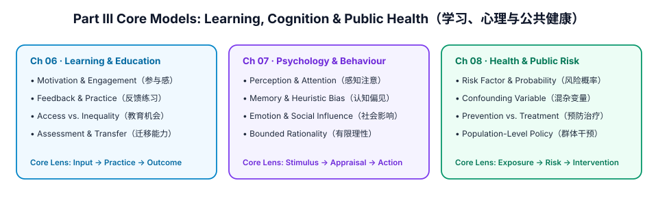

## Learning as Skill Development（学习作为能力发展）

Learning（学习）changes how a person thinks, what they can do, and how they respond to new situations. When a person learns, the brain undergoes structural and functional changes（结构和功能变化）: synapses（突触）strengthen between neurons that fire together, neural pathways（神经通路）become more efficient through myelination（髓鞘化）, and new patterns of activation（激活模式）emerge across cortical regions（皮层区域）. This neural plasticity（神经可塑性）is the physical basis of all learning — the brain literally reorganises itself in response to experience. Plasticity continues throughout life, though the rate and ease of forming new connections change with age, prior experience, and the nature of the material being learned.

Skill development（能力发展）is a central dimension of learning. A skill（能力 / 技能）is the capacity to perform a task effectively, typically acquired through instruction, practice, and experience. Cognitive skills（认知技能）involve thinking, reasoning, and mental processing — reading comprehension（阅读理解）, mathematical calculation（数学计算）, logical analysis（逻辑分析）, problem-solving（问题解决）, and critical thinking（批判性思维）. Physical skills（身体技能）involve coordinated movement — writing, typing, playing a musical instrument（乐器）, performing surgery（手术）, or operating machinery. Most real-world skills combine both dimensions: a surgeon needs cognitive knowledge of anatomy（解剖学知识）and physical dexterity（手部灵活性）to perform an operation; a pilot needs cognitive understanding of aerodynamics（空气动力学）and physical coordination（身体协调）to fly an aircraft.

Learning progresses through stages of increasing automaticity（自动化程度）. At the beginning, a learner needs conscious attention（有意识的注意）and deliberate effort to perform each component of a new skill. A person learning to drive must think consciously about checking mirrors, pressing the clutch（离合器）, turning the steering wheel, monitoring traffic, and coordinating these actions simultaneously. This cognitive load（认知负荷）is high because working memory（工作记忆）must process each component separately, and working memory has limited capacity（有限容量）— typically holding about four to seven items at once. When too many components demand attention simultaneously, performance degrades: the learner stalls the engine, misses a traffic signal, or forgets to check the blind spot（盲区）.

With sustained practice, the skill becomes more procedural（程序化的）. Individual actions that once required separate attention become integrated into larger units of behaviour（行为单元）— called chunking（组块化）. The experienced driver no longer thinks about each pedal movement; the sequence of pressing the clutch, shifting gear（换挡）, and releasing the clutch becomes a single fluid action controlled as one unit. This integration frees working memory capacity for higher-level tasks — navigating unfamiliar routes, anticipating other drivers' behaviour, and responding to unexpected situations. The transition from controlled processing（控制性加工）to automatic processing（自动加工）is a fundamental mechanism of skill acquisition（技能习得）. Controlled processing is slow, effortful, and attention-demanding; automatic processing is fast, effortless, and does not require conscious attention. Reading provides a clear illustration: a beginning reader（初读者）must decode each letter and sound consciously, while an experienced reader recognises words and phrases automatically, allocating attention to comprehension（理解）rather than decoding（解码）.

Prior knowledge（先前知识）strongly influences how new learning occurs. New information is understood by connecting it to existing mental structures — schemas（图式）— that organise knowledge in the brain. A learner who already understands basic ecological principles（基本生态学原理）will learn new concepts about biodiversity（生物多样性）more quickly because the new information can be attached to existing schemas about ecosystems, species interactions, and environmental pressure. A learner with no ecological background must build the schema from scratch while also processing the new information — a substantially more demanding cognitive task. This is why learning is cumulative（累积性的）: each new piece of knowledge creates connection points（连接点）that make the next piece easier to acquire, understand, and retain. The gap between learners with rich and poor prior knowledge widens over time because the learner with more knowledge learns faster from each new experience — a phenomenon called the Matthew effect（马太效应）in learning.

The quality of instruction（教学质量）affects learning outcomes through its interaction with the learner's current level of expertise. Explicit instruction（显性教学）provides clear explanations, worked examples（示范例题）, and guided practice（有指导的练习）that reduce cognitive load for novices（新手）by structuring the material and directing attention to essential features. Discovery learning（发现式学习）— where learners explore problems and find patterns independently — can be effective for advanced learners who already possess sufficient background knowledge to organise new information without external guidance. The expertise reversal effect（专长逆转效应）describes how instructional methods that benefit novices can become ineffective or even counterproductive for more expert learners, and vice versa. Effective instruction therefore adapts its level of structure and guidance to the learner's position on the novice-to-expert continuum（从新手到专家的连续体）.

Learning therefore functions as the mechanism through which neural structure, cognitive capacity, and behavioural capability change in response to experience. The vocabulary of learning — neural plasticity, automaticity, cognitive load, chunking, controlled processing, automatic processing, schema, prior knowledge, explicit instruction — names the processes through which the brain reorganises itself and the instructional choices that support or hinder that reorganisation. Educational texts use this vocabulary to trace the pathways from instruction through cognitive processing to the skill development that determines what learners can do and how they respond to new challenges.

## Practice, Feedback, and Performance（练习、反馈与表现）

Practice（练习）is the repeated engagement with a task directed toward improvement. Practice is essential for developing any skill, but the amount of practice alone does not determine the level of skill achieved — the quality, structure, and focus of practice matter at least as much. Research on expert performance（专家表现）consistently shows that how people practice is more predictive of eventual achievement（最终成就）than how long they practice.

Deliberate practice（刻意练习）is a specific form of practice designed to produce maximum improvement. It involves focused attention（集中注意力）on specific aspects of performance that need improvement, clear goals（明确目标）for each practice session, and immediate feedback（即时反馈）that allows the learner to detect and correct errors. A musician practising a difficult passage slowly, isolating the specific technical challenge（技术难点）, repeating it with attention to each note, and correcting errors as they occur is engaging in deliberate practice. A musician playing through an entire piece from beginning to end without stopping, ignoring mistakes, and repeating the same performance is engaging in naive practice（天真的练习）— repetition without targeted improvement. The first approach produces faster and deeper improvement because it identifies specific weaknesses and builds precision at the component level（组件层面）.

The distinction between naive and deliberate practice explains why some individuals improve rapidly while others plateau（达到平台期）despite years of experience. A teacher who has taught for twenty years may not be substantially better than one who has taught for five if both have been performing the same routines without deliberate effort to improve specific aspects of their practice. A student who reads the same textbook chapter three times without actively engaging with the content is practising naively. A student who reads the chapter once, then closes the book and attempts to recall the main points（主动回忆）, checks accuracy against the text, identifies gaps, and re-studies only the weak areas is practising deliberately. The second student will retain more and understand more deeply because the practice includes active retrieval（主动提取）, self-assessment（自我评估）, and targeted re-study（有针对性的重新学习）.

Feedback（反馈）is information about performance that helps the learner identify what is correct, what needs improvement, and how to adjust. Feedback can come from a teacher, from peers（同伴）, from self-assessment, or from the outcome of the task itself — a mathematical calculation either produces the correct answer or it does not. Effective feedback has several characteristics that distinguish it from generic praise or criticism. It is specific（具体的）— identifying exactly what was done correctly and what needs improvement: "Your thesis statement（论点陈述）clearly states your position, but your second paragraph lacks evidence to support the claim" is more useful than "Your essay needs work." It is timely（及时的）— feedback given immediately after performance is more effective than feedback delayed by days or weeks, because the learner can still connect the feedback to their specific actions. It is task-focused（任务导向的）rather than person-focused — "This argument needs stronger evidence" directs attention to the work, while "You are not good at arguing" directs attention to the person and can undermine motivation（动机）.

Feedback operates through a discrepancy reduction mechanism（差异缩减机制）. The learner compares their current performance（当前表现）with a desired standard（目标标准）, identifies the gap（差距）, and adjusts their approach to reduce it. This cycle requires three elements: a clear standard that defines what good performance looks like, accurate information about current performance relative to that standard, and strategies（策略）for closing the gap. Without a clear standard, feedback has no target — the learner does not know what to aim for. Without accurate feedback, the learner cannot know whether their adjustments are correct and may practise errors repeatedly. Without strategies for improvement, the learner knows the gap exists but does not know how to close it. This is why clear learning objectives（学习目标）, accurate assessment（准确评估）, and explicit strategy instruction（显性策略教学）are essential components of effective instruction.

Performance（表现）is the observable result of learning — test scores（考试成绩）, completed tasks, demonstrations, or real-world applications. Performance and learning are related but distinct. A student may perform well on a test through rote memorisation（死记硬背）without developing deep understanding（深层理解）, then forget the material rapidly after the test. Another student may understand the material deeply but perform poorly because of test anxiety（考试焦虑）, unfamiliar question formats（不熟悉的题型）, or time pressure（时间压力）. Performance is the best available indicator of learning, but it is an imperfect one. Desirable difficulties（合意困难）— conditions that make learning feel harder during practice, such as spaced practice（间隔练习）, interleaved practice（交错练习）, and retrieval practice（提取练习）— often produce lower immediate performance but stronger long-term retention（长期保持）and transfer（迁移）. The learner who appears to be struggling during practice may be learning more deeply than the learner who performs smoothly.

Plateaus（学习平台期）occur when performance stops improving despite continued practice. A plateau may indicate that the current practice method has exhausted its potential, that foundational knowledge gaps（基础知识缺口）are limiting further progress, or that the learner needs to restructure their approach rather than simply repeat it. Breaking through a plateau typically requires changing the practice strategy — focusing on different components of the skill, seeking new feedback from different sources, addressing underlying knowledge weaknesses, or increasing the difficulty level to create new learning challenges. Plateaus are a normal feature of skill development rather than a sign of failure; they represent periods of consolidation（巩固期）where the brain integrates previously acquired skills before the next phase of improvement begins.

Practice and feedback therefore form the mechanism through which skills develop and improve over time. The vocabulary of practice — deliberate practice, naive practice, feedback, discrepancy reduction, desirable difficulty, plateau, consolidation — names the processes through which repeated engagement with a task produces improvement and the conditions that determine whether practice leads to mastery or stagnation. Educational texts use this vocabulary to trace the pathways from practice design through feedback quality to the performance outcomes that determine whether learners develop the skills they need to succeed in academic and professional contexts.

## Assessment and Educational Standards（评估与教育标准）

Assessment（评估）measures what a learner knows, understands, or can do. It serves multiple purposes: diagnosing the learner's current level（诊断当前水平）, identifying areas needing improvement, guiding instructional decisions（指导教学决策）, certifying achievement（认证成就）, and evaluating the effectiveness of educational programmes（评估教育项目的有效性）. Assessment is not a single activity but a family of practices that differ in purpose, timing, method, and the way results are used.

Formative assessment（形成性评估）occurs during the learning process and provides ongoing feedback to both the learner and the teacher about progress toward learning goals. A short quiz after a lesson, a teacher's comment on a draft essay（草稿论文的评语）, a classroom discussion where the teacher probes understanding（探查理解）, or a quick show-of-hands survey are all formative assessments. The defining feature is that the information is used to adjust teaching and learning while they are still happening — the teacher may re-explain a concept that students did not grasp, the learner may spend more time on a weak area, or the class may revisit a topic that the assessment revealed was poorly understood. Formative assessment functions as a feedback loop（反馈循环）within the learning process itself, providing the information that both teacher and learner need to make decisions about what to do next.

Summative assessment（总结性评估）occurs at the end of a learning period and measures what the learner has achieved overall. Final examinations（期末考试）, end-of-term projects（期末项目）, standardised proficiency tests（标准化水平测试）, and certification examinations（认证考试）are summative assessments. They provide a summary of achievement（成就总结）at a point in time and are used for certification, selection（选拔）, progression（升学）, and accountability（问责）— determining who has reached a required standard, who should advance to the next level, and whether an educational programme is effective. The same test can serve formative or summative purposes depending on how its results are used: a mid-term exam that identifies areas for improvement before the final exam is being used formatively; the same exam that counts toward the final course grade is being used summatively.

Assessment validity（评估效度）refers to whether an assessment measures what it claims to measure. A reading comprehension test that requires specialised knowledge of quantum physics may measure physics knowledge rather than reading ability — it has low validity as a reading test. A mathematics test that requires advanced reading skills to understand the word problems（应用题）may measure reading ability rather than mathematical understanding. Validity is the most important quality of an assessment because an invalid assessment provides misleading information — it tells teachers, students, and institutions something different from what they believe it is telling them. Construct validity（构念效度）asks whether the test actually measures the underlying cognitive construct（认知构念）it is designed to measure. Content validity（内容效度）asks whether the test covers the full range of knowledge and skills that the curriculum intends to develop.

Assessment reliability（评估信度）refers to whether an assessment produces consistent results across repeated administrations（重复施测）, different markers（不同评分者）, and different testing occasions. A reliable test gives similar results when the same person takes it on different occasions (test-retest reliability / 重测信度) and when different markers score the same response (inter-rater reliability / 评分者间信度). Reliability is necessary but not sufficient for a good assessment — a test can be reliably measuring the wrong construct (reliable but not valid), but a test cannot be valid if it is not reliable, because inconsistent measurement cannot accurately capture any construct. Standardisation（标准化）of test administration（施测）, scoring procedures（评分程序）, and testing conditions（测试条件）improves reliability by reducing sources of variation that are unrelated to the construct being measured.

Educational standards（教育标准）define the expected levels of knowledge and skill that learners should achieve at different stages of education. Standards serve several functions in educational systems. They ensure consistent quality（一致的质量）across different schools, regions, and teachers by establishing common expectations. They provide a framework for assessment — when all students are taught toward the same standards, standardised assessments can compare achievement across different contexts. They communicate expectations to teachers, students, and parents, creating shared understanding of what educational success means. They guide curriculum development（课程开发）, textbook design（教材设计）, and teacher training（教师培训）by specifying the knowledge and skills that instruction should target.

Standard-setting（标准制定）involves decisions about what content is most important, what level of performance is acceptable, and how progress should be measured. These decisions are not purely technical — they reflect values（价值观）about what knowledge and skills are most valuable for individuals and society, what level of achievement is expected of all students versus what is aspirational（理想性的）, and how educational resources should be allocated. Different countries and educational systems make different choices about standards, reflecting different cultural priorities（文化优先事项）, economic needs（经济需求）, and historical traditions（历史传统）. International assessments（国际评估）such as PISA（国际学生评估项目）and TIMSS（国际数学与科学趋势研究）allow comparison of educational outcomes across countries, revealing how different standards, curricula, and teaching approaches produce different patterns of student achievement（学生成就）.

Assessment and standards therefore function as the mechanisms through which educational systems measure, compare, and communicate what learners know and can do. The vocabulary of assessment — formative assessment, summative assessment, validity, reliability, educational standard, standard-setting, construct validity, content validity — names the tools through which educators evaluate learning and the quality criteria that determine whether those evaluations are trustworthy. Educational texts use this vocabulary to trace the pathways from assessment design through measurement quality to the decisions that determine which students advance, which programmes receive support, and how educational systems hold themselves accountable for student learning.

::: {.content-visible when-format="html"}

:::

## Motivation, Engagement, and Confidence（动机、参与感与信心）

Motivation（动机）is the internal drive（内在驱动力）that directs behaviour toward a goal, determines how much effort a person invests, and sustains that effort when facing difficulties. Motivation is not a single quality but a complex interaction of beliefs, values, emotions, expectations, and environmental conditions. It determines why a person chooses to engage in an activity, how intensely they focus, and how long they persist before giving up.

Intrinsic motivation（内在动机）originates from the learner's own interest in the material, enjoyment of the activity, or satisfaction from mastering a challenge（掌握挑战的满足感）. A student who reads books about astronomy（天文学）because they find the universe fascinating is intrinsically motivated. Intrinsic motivation is associated with deeper learning（更深层的学习）, greater creativity（更大的创造力）, and longer persistence（更持久的坚持）. When learners are genuinely interested, they allocate more attention, process information more thoroughly through elaboration（精细加工）and connection to existing knowledge, and are more likely to use effective learning strategies such as self-questioning（自我提问）and concept mapping（概念图）.

Extrinsic motivation（外在动机）comes from external rewards（外部奖励）or pressures（外部压力）— grades（成绩）, praise（表扬）, prizes, scholarships（奖学金）, parental expectations（父母期望）, or avoidance of punishment（避免惩罚）. A student who studies primarily to achieve high exam scores is extrinsically motivated. Extrinsic motivation can be effective, particularly for tasks that are not inherently interesting but are necessary for longer-term goals. However, extrinsic motivation may not sustain learning after the external reward is removed. Excessive reliance on extrinsic rewards can reduce intrinsic motivation through the overjustification effect（过度理由效应）— when external rewards are introduced for an activity the learner already enjoys, the learner may begin to attribute their engagement to the reward rather than to their own interest, and when the reward is removed, motivation declines below its original level.

Self-determination theory（自我决定理论）identifies three basic psychological needs（基本心理需求）that support intrinsic motivation and wellbeing: autonomy（自主性）— the feeling of having choice and control over one's actions; competence（胜任感）— the feeling of being effective and capable of meeting challenges; and relatedness（归属感）— the feeling of being connected to others and valued within a community. Learning environments that support these needs — by offering meaningful choices, providing appropriately challenging tasks, and creating supportive relationships — tend to produce higher motivation, deeper engagement, and better outcomes. Environments that frustrate these needs — through excessive control, tasks that are too easy or too difficult, or social isolation — tend to reduce motivation and increase disengagement（脱离参与）and dropout（辍学）.

Engagement（参与感）refers to the learner's active involvement in the learning process. An engaged learner pays attention, asks questions, tries to understand rather than merely complete tasks, and connects new information to existing knowledge. Engagement has three dimensions that operate simultaneously. Behavioural engagement（行为参与）involves effort, persistence, attendance, and participation in learning activities. Cognitive engagement（认知参与）involves deep processing（深度加工）, elaboration, use of learning strategies, and investment in understanding rather than surface completion. Emotional engagement（情感参与）involves interest, enjoyment, a sense of belonging（归属感）, and positive attitudes toward learning. All three dimensions contribute to learning outcomes, and a student may be engaged in one dimension while disengaged in another — attending class regularly (behavioural) while not processing the material deeply (cognitive).

Engagement is higher when the material is relevant to the learner's life and goals, when the task is appropriately challenging — within the zone of proximal development（最近发展区）, the range of tasks that a learner cannot yet do independently but can accomplish with guidance and support — and when the learner feels a sense of control over their learning. Tasks that are too easy produce boredom（厌倦）; tasks that are too difficult produce frustration（挫败感）and anxiety（焦虑）. The optimal challenge point（最佳挑战点）maintains engagement by stretching the learner's current abilities without exceeding them, creating the conditions for flow（心流）— a state of deep absorption（深度沉浸）where time seems to pass quickly and performance is at its peak.

Confidence（信心）— specifically self-efficacy（自我效能感）— is the learner's belief in their own ability to succeed at specific tasks. Learners with high self-efficacy are more likely to attempt challenging tasks, persist when encountering difficulties, use effective learning strategies, and recover from setbacks（挫折）. Learners with low self-efficacy may avoid challenging tasks, give up easily, attribute failure to lack of ability（能力不足）rather than to insufficient effort or poor strategy, and experience anxiety that further impairs performance. Self-efficacy is built through four sources: mastery experience（掌握经验）— successfully completing challenging tasks — is the most powerful source; vicarious experience（替代经验）— observing similar others succeed — builds confidence through social modelling（社会示范）; social persuasion（社会说服）— encouragement from teachers, peers, or parents — can boost confidence, though its effects are weaker than direct experience; and physiological states（生理状态）— anxiety, fatigue, and stress can signal to the learner that they are not capable, reducing confidence even when actual ability is adequate.

Motivation, engagement, and confidence form a positive feedback cycle（正向反馈循环）. Success builds confidence, which increases motivation, which leads to more engagement, which produces more success. A learner who experiences early success in a subject is more likely to remain motivated, engaged, and confident throughout their education. A learner who experiences early failure may lose confidence, reduce engagement, and enter a negative cycle（负向循环）where reduced effort produces further failure, confirming the belief that they are incapable. This dynamic explains why early learning experiences（早期学习体验）are disproportionately important — they set the trajectory（轨迹）for future motivation, engagement, and achievement across the learner's entire educational career.

Motivation and engagement therefore represent the psychological forces that drive learners to start, sustain, and deepen their learning efforts. The vocabulary of motivation — intrinsic motivation, extrinsic motivation, self-determination theory, autonomy, competence, relatedness, engagement, self-efficacy, mastery experience, zone of proximal development — names the psychological needs and environmental conditions that determine whether learners invest effort in learning or withdraw from it. Educational texts use this vocabulary to trace the pathways from learning environment design through psychological response to the engagement outcomes that determine whether learners persist through challenges or abandon their educational goals.

## Family Background and Educational Opportunity（家庭背景与教育机会）

Family background（家庭背景）exerts a powerful influence on educational outcomes through multiple mechanisms that operate from birth through adolescence and beyond. Children from families with higher income（更高收入）, more educated parents（受教育程度更高的父母）, and more resources at home tend to perform better in school on average. This relationship is one of the most consistent findings in educational research, observed across countries, time periods, educational systems, and assessment methods. The mechanisms connecting family background to educational outcomes are multiple, cumulative, and deeply embedded in social and economic structures.

Economic resources（经济资源）allow families to provide educational materials（教育材料）— books, computers, educational toys（教育玩具）— private tutoring（私人辅导）, enrichment activities（拓展活动）such as music lessons and science camps, and a quiet, stable environment for study. They also reduce the need for children to work part-time jobs or care for younger siblings（弟妹）during study time. Economic security（经济安全）reduces chronic stress（慢性压力）in the household, which affects children's cognitive development（认知发展）, attention regulation（注意力调节）, and emotional wellbeing（情感健康）. Poverty（贫困）creates conditions — food insecurity（粮食不安全）, housing instability（住房不稳定）, exposure to environmental toxins（环境毒素）, and chronic stress — that directly impair the cognitive and physiological capacities that learning depends on.

Cultural resources（文化资源）include parents' knowledge of how the education system works, their ability to help with homework（辅导作业）, their familiarity with academic language（学术语言）and expectations, and their capacity to advocate for（为...争取）their children within the school system. Parents with higher education are more likely to read to their children from an early age, engage them in conversation（对话）that builds vocabulary（词汇量）and reasoning skills（推理能力）, and model learning behaviours（学习行为示范）that children internalise. The "word gap"（词汇差距）research has documented that children from more educated families hear millions more words by age four than children from less educated families, creating a language development advantage（语言发展优势）that persists throughout schooling.

Social capital（社会资本）— the networks, relationships, and information that flow through them — affects educational opportunity through access to information（信息获取）, mentorship（导师指导）, and institutional navigation（制度导航）. Parents with professional networks（职业网络）can find better information about schools, teachers, and educational programmes. They can connect their children to internships（实习）, mentors, and educational experiences that build advantage. They understand how to navigate admission processes（招生流程）, appeal decisions, and access resources that less connected families may not know exist. These advantages accumulate over time（随时间累积）, creating a widening gap between children from advantaged and disadvantaged backgrounds — a process that sociologists call cumulative advantage（累积优势）.

Educational inequality（教育不平等）operates through multiple institutional channels（制度渠道）. School funding（学校经费）is often tied to local property taxes（地方财产税）, meaning that schools in wealthy neighbourhoods have more resources — better facilities（更好的设施）, smaller class sizes（更小的班级规模）, more experienced teachers, and richer curricula — than schools in poor neighbourhoods. Teacher quality（教师质量）is distributed unequally: more experienced and qualified teachers often prefer to work in schools with better conditions, higher-achieving students, and more supportive communities, leaving the most challenging schools staffed by less experienced teachers. Peer effects（同伴效应）mean that students learn from each other, and students in schools with more advantaged peers benefit from higher academic expectations（更高的学术期望）, fewer behavioural disruptions（行为干扰）, more academic discussion, and social norms（社会规范）that value educational achievement.

The consequences of educational inequality extend far beyond school. Education is strongly linked to future income（未来收入）, health outcomes（健康结果）, civic participation（公民参与）, and social mobility（社会流动）. People with more education earn higher salaries, have better health, live longer, and participate more actively in democratic processes（民主过程）. When educational opportunities are unequal, these benefits are also unequally distributed, and inequality is transmitted from one generation to the next — a phenomenon called the intergenerational transmission of inequality（不平等的代际传递）. Children who receive less education because of family background are more likely to have children who also receive less education, perpetuating the cycle across generations.

Family background and educational opportunity therefore represent the mechanisms through which social and economic conditions outside the school shape educational outcomes inside it. The vocabulary of educational inequality — family background, economic resources, cultural resources, social capital, school funding, teacher quality, peer effect, intergenerational transmission — names the pathways through which advantage and disadvantage accumulate across a child's educational career. Educational texts use this vocabulary to trace the connections from family circumstances through institutional channels to the educational outcomes that determine whether students have equal opportunities to succeed or whether their life chances are shaped by the circumstances of their birth.

## Digital Learning and Educational Technology（数字学习与教育技术）

Digital learning（数字学习）uses technology to deliver, support, or enhance education. It encompasses a wide range of tools and approaches: online courses（在线课程）, educational apps（教育应用程序）, interactive simulations（交互式模拟）, video lectures（视频讲座）, digital textbooks（数字教材）, virtual classrooms（虚拟课堂）, adaptive learning systems（自适应学习系统）, and AI-powered tutoring（人工智能辅导）. Technology can make education more accessible, more flexible, and more personalised, but it also introduces new challenges related to equity, quality, and the development of self-regulated learning skills.

Accessibility（可及性）is one of the most significant benefits of digital learning. Online courses allow students to access educational content from anywhere with an internet connection（互联网连接）. A student in a remote village can take a course from a university in another country. A working adult can study in the evening after their job. A person with a physical disability（身体残疾）who cannot attend a traditional classroom can participate fully in online learning. This flexibility makes education available to people who face geographic, financial, temporal, or physical barriers（地理、经济、时间或物理障碍）to traditional schooling. Massive open online courses（大规模开放在线课程 / MOOCs）have made content from elite universities（精英大学）available to millions of learners worldwide at little or no cost.

Personalisation（个性化）is another major advantage. Adaptive learning systems（自适应学习系统）adjust the difficulty, pace, and content of lessons based on the learner's ongoing performance. When a student answers a question correctly, the system advances to a harder question or a new topic. When they answer incorrectly, the system provides additional explanation, worked examples, and practice problems targeting the specific misconception（特定误解）. This individualised approach（个性化方法）can be more efficient than a one-size-fits-all classroom lesson because each student spends time on exactly what they need to learn rather than reviewing material they have already mastered or struggling with material they are not yet ready for.

Learning analytics（学习分析）uses data generated by digital learning platforms to understand how students learn and to improve educational outcomes. Platforms can track which resources students use, how much time they spend on each task, which questions they answer incorrectly and in what patterns, how quickly they progress, and what behaviours predict success or failure. This data can help teachers identify struggling students early（早期识别困难学生）, improve course design by revealing which materials are most and least effective, and provide targeted support（针对性支持）to students who need it most. Predictive models（预测模型）can flag students at risk of failing or dropping out before the outcome occurs, allowing preventive intervention（预防性干预）.

The digital divide（数字鸿沟）limits the benefits of digital learning for the populations that could benefit most. Reliable internet access（可靠的互联网接入）, suitable devices（合适的设备）, and digital literacy（数字素养）are not equally distributed. Students from low-income families, rural areas（农村地区）, and developing countries（发展中国家）are disproportionately affected by lack of access. The digital divide means that technology, which could reduce educational inequality by making high-quality content universally available, may actually increase inequality if access to that technology is itself unequally distributed — a phenomenon called the Matthew effect in technology adoption（技术采用中的马太效应）.

Online learning requires self-regulation skills（自我调节能力）that not all learners have developed. Successful online learners must manage their time（时间管理）, set goals（设定目标）, maintain motivation without external structure, monitor their own comprehension（监控自身理解）, and seek help when needed — all without the physical presence of a teacher and the social structure of a classroom. Students who lack these self-regulation skills may struggle with online learning even when the content and instruction are of high quality. Younger learners and those with less prior educational success tend to have weaker self-regulation skills, creating a paradox（悖论）where the students who most need flexible learning options are least equipped to benefit from them without additional support.

The effectiveness of digital learning depends fundamentally on how it is designed and implemented, not merely on the presence of technology. Simply transferring traditional lectures to a video format produces limited benefits. Effective digital learning incorporates principles of good instruction（良好教学原则）: clear learning objectives, active learning activities（主动学习活动）, frequent practice with feedback, spaced retrieval（间隔提取）, and opportunities for interaction with instructors and peers. The most effective approaches combine digital tools with human teaching — a model called blended learning（混合学习）— where technology provides practice, feedback, adaptive content, and data analytics, while teachers provide explanation, motivation, guidance, emotional support, and the human connection that technology cannot replicate.

Digital learning therefore represents the mechanism through which technology transforms where, when, and how learning occurs. The vocabulary of digital learning — adaptive learning system, learning analytics, digital divide, self-regulation, blended learning, massive open online course — names the tools and challenges through which technology reshapes educational access and the conditions that determine whether digital learning reduces or widens existing inequalities. Educational texts use this vocabulary to trace the pathways from technological innovation through implementation quality to the learning outcomes that determine whether digital learning fulfills its promise of making education more accessible and personalised or whether it creates new barriers for the students who need it most.

## Educational Inequality and Access（教育不平等与教育机会）

Educational inequality（教育不平等）refers to systematic differences in educational outcomes（教育成果的系统性差异）between different groups of students — differences that are related to socioeconomic status（社会经济地位）, race（种族）, ethnicity（民族）, gender（性别）, geographic location（地理位置）, disability（残疾）, or immigration status（移民身份）rather than to individual ability or effort. Educational inequality is a persistent feature of almost every educational system in the world, though its magnitude（幅度）varies across countries and over time depending on policy choices, social structures, and economic conditions.

Access to education（教育机会）means the ability of all people to participate in education regardless of their background or circumstances. Access has multiple dimensions that must all be addressed for education to be genuinely available. Physical access（物理可及性）means that schools exist within reasonable distance, are physically accessible to students with disabilities, and that safe transportation（安全交通）is available. Economic access（经济可及性）means that families can afford school fees（学费）, uniforms（校服）, books, transport, and the opportunity cost（机会成本）of sending children to school rather than to work. Social access（社会可及性）means that students from all backgrounds feel welcome and included in educational institutions, without facing discrimination（歧视）, prejudice（偏见）, cultural barriers（文化障碍）, or language barriers（语言障碍）that prevent full participation.

Universal access to primary education（普及初等教育）has been largely achieved worldwide — most children in most countries now complete primary school. Access to secondary education（中等教育）and higher education（高等教育）remains far more unequal. In many countries, students from wealthy families are dramatically more likely to attend university（上大学）than students from poor families, even when they have similar academic ability. This gap reflects both economic barriers — the direct cost of tuition（学费）and living expenses（生活费）, and the opportunity cost of years spent studying rather than earning — and social barriers — differences in information about university options（大学选择信息）, expectations（期望）about who belongs in higher education, and cultural familiarity（文化熟悉度）with academic environments.

Tracking（分轨制）— separating students into different educational pathways（教育路径）based on perceived ability or achievement — can increase inequality when placement in tracks correlates with social background. Students from advantaged backgrounds are more likely to be placed in academic tracks（学术轨道）that lead to university, while students from disadvantaged backgrounds are more likely to be placed in vocational tracks（职业轨道）that lead to lower-status occupations. Once placed, students in different tracks receive different curricula（课程）, different quality of instruction, and different opportunities, making it difficult to move between tracks later. Tracking can therefore crystallise early advantages and disadvantages into permanent educational and occupational trajectories（职业轨迹）.

Policies to improve educational access（改善教育机会的政策）target different barriers at different levels. Eliminating school fees（取消学费）reduces economic barriers and has dramatically increased enrolment（入学率）in many developing countries. Need-based scholarships（基于需求的奖学金）help low-income students afford higher education. Conditional cash transfers（有条件现金转移）— payments to poor families contingent on（以...为条件）children's school attendance — address the opportunity cost of education. Building schools in underserved areas（服务不足地区）improves physical access. Teacher training（教师培训）and curriculum reform（课程改革）improve the quality of education available to all students. Affirmative action policies（平权政策）give preference to students from disadvantaged groups in university admissions（大学录取）, addressing historical exclusion（历史性排斥）and creating pathways for underrepresented populations（代表性不足的群体）.

The consequences of educational inequality extend far beyond the individual to affect entire societies. Societies with high educational inequality tend to have lower overall economic growth（经济增长）because human talent（人才）is wasted when capable individuals cannot access quality education. They experience higher social tension（社会紧张）, lower social mobility（社会流动性）, and weaker democratic participation（民主参与）. When talent is wasted because of unequal opportunity, the loss is shared — the individuals denied opportunity suffer directly, and the society that fails to develop their potential contributions loses the innovation, productivity, and civic engagement（公民参与）that those individuals would have provided. Reducing educational inequality is therefore both a moral imperative（道德义务）and an economic strategy（经济策略）that benefits the entire society.

Educational inequality and access therefore represent the mechanisms through which educational systems distribute opportunity and how this distribution affects individuals and societies. The vocabulary of educational access — physical access, economic access, social access, tracking, affirmative action, social mobility, intergenerational transmission, achievement gap（成就差距）— names the barriers that prevent equal participation in education and the policies used to remove those barriers. Educational texts use this vocabulary to trace the pathways from social background through institutional practices to the educational outcomes that determine whether students have equal opportunities to succeed or whether their life chances are shaped by the circumstances of their birth and the policies that either reinforce or reduce those circumstances.

::: {.content-visible when-format="html"}

:::

