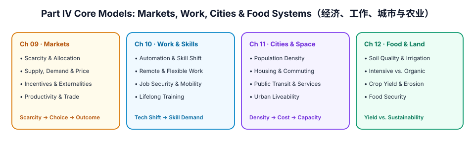

## Scarcity and Resource Allocation（稀缺性与资源分配）

Economics begins with a fundamental condition: resources are limited, but human wants are effectively unlimited. This condition is scarcity（稀缺性）— the gap between what people desire and what available resources can produce. Even the wealthiest societies face scarcity because wants always exceed available resources, time, and productive capacity. The fundamental economic problem（基本经济问题）is how to allocate scarce resources（稀缺资源）among competing uses to satisfy human needs and wants as effectively as possible. Every society, regardless of its political system, level of development, or cultural values, must answer this problem.

Resources（资源）are the inputs（投入）used to produce goods and services（商品和服务）. Economists classify them into several categories. Land（土地）includes all natural resources — land itself, water, minerals, oil, forests, fisheries（渔业资源）, and other natural materials that exist independently of human production. Labour（劳动）is the human effort — physical and mental — applied to production. Capital（资本）refers to the produced means of production（生产出来的生产手段）— tools, machinery, buildings, equipment, and infrastructure used to produce other goods and services. Human capital（人力资本）— the knowledge, skills, abilities, and health embodied in workers（体现在工人身上的知识、技能、能力和健康）— is often distinguished from physical capital because it is accumulated through education, training, and experience rather than through investment in machinery. Entrepreneurship（企业家才能）— the ability to combine resources in new ways, identify opportunities（识别机会）, and bear risk（承担风险）— drives innovation and economic organisation.

Resource allocation（资源分配）is the process of deciding how to distribute scarce resources among competing uses. Every society must answer three fundamental questions: What goods and services should be produced, and in what quantities? How should they be produced — using which combination of resources and technologies? Who should receive the output — how should the total production be distributed among the population? Different economic systems（经济体系）answer these questions through different mechanisms. In a market economy（市场经济）, these decisions emerge from the interactions of millions of buyers and sellers in markets, coordinated by prices（价格）that transmit information about scarcity and preferences. In a command economy（指令经济）, the government makes these decisions centrally through planning agencies（计划机构）that determine production targets, allocate resources, and set prices. Most real-world economies are mixed economies（混合经济）that combine market allocation with government intervention（政府干预）to correct market failures（市场失灵）, provide public goods（公共物品）, redistribute resources, and pursue social objectives（社会目标）.

Scarcity means that every choice has a cost — choosing one thing requires giving up another. Opportunity cost（机会成本）is the value of the next best alternative（次优替代方案）that is forgone when a choice is made. If a government spends one billion dollars on a new highway（高速公路）, the opportunity cost is the hospitals, schools, or other infrastructure that the same resources could have built. If a student spends three hours studying economics, the opportunity cost is the three hours that could have been spent studying another subject, working for income, or resting. Opportunity cost is the true cost of any decision because it captures what is sacrificed（被牺牲的）, not merely what is spent in monetary terms（货币支出）. The concept of opportunity cost is the foundation of economic thinking（经济思维的基础）because it forces explicit recognition that every choice involves trade-offs（权衡）and that resources devoted to one purpose cannot simultaneously serve another.

The production possibilities frontier（生产可能性边界 / PPF）illustrates scarcity, choice, and opportunity cost graphically. It shows the maximum combinations of two goods (or categories of goods) that an economy can produce given its available resources and technology, assuming all resources are fully and efficiently employed. Points on the frontier represent efficient production（有效率的生产）— all resources are fully used and allocated optimally. Points inside the frontier represent inefficient production（无效率的生产）— resources are unemployed（失业的）or misallocated（错配的）. Points outside the frontier are unattainable（不可达到的）with current resources and technology. Moving along the frontier from one combination to another reveals the opportunity cost of producing more of one good in terms of the other good that must be given up. Economic growth（经济增长）— produced by accumulating more resources or improving technology — shifts the frontier outward, making previously unattainable combinations possible.

Scarcity therefore functions as the fundamental condition that makes economic choice necessary and the different ways societies organise to make those choices. The vocabulary of scarcity — scarcity, opportunity cost, resource allocation, land, labour, capital, human capital, market economy, command economy, mixed economy, production possibilities frontier — names the resources that societies must allocate and the mechanisms through which those allocations are determined. Economic texts use this vocabulary to trace the pathways from resource constraints through allocation mechanisms to the economic outcomes that determine what goods and services are produced, how they are produced, and who receives them.

## Demand, Supply, and Price Signals（需求、供给与价格信号）

Demand（需求）describes how much of a good or service consumers are willing and able to buy at different prices during a given period. The law of demand（需求定律）states that, all else being equal（其他条件不变）, as the price of a good falls, the quantity demanded（需求量）increases, and as the price rises, the quantity demanded decreases. This inverse relationship（反向关系）between price and quantity demanded reflects two underlying effects. The substitution effect（替代效应）occurs when consumers switch to cheaper alternatives（更便宜的替代品）as the price of a good rises — if beef becomes more expensive, consumers buy more chicken. The income effect（收入效应）occurs when a price rise reduces consumers' real purchasing power（实际购买力）, making them effectively poorer and causing them to buy less of the good (and of other goods as well).

Demand is not the same as desire（欲望）or need（需要）. For demand to exist in the economic sense, consumers must have both the willingness to buy（购买意愿）and the ability to pay（支付能力）. A person may desperately want a luxury car but cannot afford it — this desire does not constitute demand. Demand is effective demand（有效需求）— want backed by purchasing power（购买力）. This distinction matters because markets respond only to effective demand: goods are produced for people who can pay for them, not for people who merely want them. This is why markets may fail to provide essential goods（基本商品）to poor populations who need them but cannot afford them.

Supply（供给）describes how much of a good or service producers are willing and able to sell at different prices during a given period. The law of supply（供给定律）states that, all else being equal, as the price of a good rises, the quantity supplied（供给量）increases, and as the price falls, the quantity supplied decreases. This positive relationship（正向关系）reflects the profit motive（利润动机）: higher prices make production more profitable, encouraging existing firms to increase output（增加产量）and new firms to enter the market. Higher prices also make it economically viable（经济上可行的）to extract resources from more costly sources or to employ more expensive production methods.

The interaction of demand and supply determines the market price（市场价格）and the quantity of goods traded（交易量）. When the quantity demanded equals the quantity supplied, the market is in equilibrium（均衡）. At the equilibrium price（均衡价格）, buyers are willing to buy exactly what sellers are willing to sell — there is no surplus（过剩）and no shortage（短缺）. The equilibrium is stable because any deviation creates forces that push the market back: if the price rises above equilibrium, a surplus develops, and sellers must lower prices to clear inventory（清理库存）; if the price falls below equilibrium, a shortage develops, and buyers bid prices up（竞价抬高）as they compete for limited supply.

Price signals（价格信号）are the information that prices convey to buyers and sellers, coordinating their decisions without central direction. A rising price signals to producers that consumers value the good more highly — encouraging increased production, investment in capacity（产能投资）, and entry of new firms. A rising price simultaneously signals to consumers that the good has become relatively scarcer — encouraging reduced consumption, substitution toward alternatives, and more efficient use. When a drought（干旱）reduces the wheat supply（小麦供给）, the resulting price increase simultaneously signals farmers to plant more wheat next season, food companies to reformulate products（重新配方产品）using alternative grains, and consumers to buy less wheat-based products. This coordination through prices（通过价格协调）is one of the most powerful features of market economies — it transmits information about scarcity and preferences across the entire economy, aligning the decisions of millions of independent actors without any central planner（中央计划者）needing to issue instructions.

Elasticity（弹性）measures how responsive（敏感的）quantity demanded or supplied is to changes in price, income, or other factors. Price elasticity of demand（需求价格弹性）is the percentage change in quantity demanded divided by the percentage change in price. Goods with close substitutes（近似替代品）— different brands of breakfast cereal（早餐谷物）, different types of cooking oil — tend to have elastic demand（弹性需求）because consumers easily switch when prices change. Goods with no close substitutes — insulin（胰岛素）for diabetics, petrol（汽油）for commuters in areas without public transport — tend to have inelastic demand（非弹性需求）because consumers continue buying even when prices rise substantially. Elasticity determines how changes in supply or demand affect prices versus quantities: when demand is inelastic, a supply reduction causes a large price increase（大幅涨价）but only a small quantity reduction; when demand is elastic, the same supply reduction causes a small price change but a large quantity reduction.

Demand and supply therefore function as the mechanism through which markets determine what is produced, how much is produced, and at what price. The vocabulary of demand and supply — law of demand, law of supply, substitution effect, income effect, effective demand, equilibrium, surplus, shortage, price signal, elasticity — names the forces that drive market outcomes and the conditions that determine whether prices adjust quickly or slowly to changes in market conditions. Economic texts use this vocabulary to trace the pathways from consumer preferences and producer costs through price adjustments to the market outcomes that determine what goods and services are available and at what cost.

## Incentives and Human Behaviour（激励与人的行为）

Incentives（激励）are factors that motivate people to act in certain ways by altering the perceived costs and benefits（感知成本与收益）of different actions. The central insight of economics is that people respond predictably to incentives — when the benefits of an action increase relative to its costs, people are more likely to take that action, and when the costs increase relative to the benefits, they are less likely. This simple principle explains a remarkable range of human behaviour, from consumer purchasing decisions to corporate investment strategies to government policy outcomes.

Positive incentives（正向激励）offer rewards for certain behaviour — a bonus（奖金）for meeting a sales target, a tax credit（税收抵免）for installing solar panels（太阳能电池板）, a scholarship（奖学金）for academic achievement, or a discount（折扣）for bulk purchasing. Negative incentives（负向激励）impose costs for certain behaviour — a fine（罚款）for littering, a tax（税收）on cigarettes, a penalty（处罚）for late payment, or imprisonment（监禁）for criminal activity. Both types change behaviour by altering the cost-benefit calculation（成本-收益计算）that individuals perform, consciously or implicitly, before acting. The effectiveness of an incentive depends on its magnitude（幅度）, its certainty（确定性）, its timing（时机）, and how the individual perceives and values the consequences.

Prices themselves function as powerful incentives that coordinate behaviour across entire economies. A high price for gasoline（汽油）incentivises people to drive less, buy more fuel-efficient cars（省油汽车）, use public transport, and carpool（拼车）. A low price incentivises more driving, larger vehicles, and longer commutes（更长的通勤）. Governments use taxes and subsidies（税收与补贴）to change incentives and influence behaviour — taxing sugar-sweetened beverages（含糖饮料）to reduce consumption and associated health costs, subsidising electric vehicles（电动汽车）to accelerate adoption and reduce emissions, or offering research and development tax credits（研发税收抵免）to encourage innovation. These policies work precisely because people respond to incentives by adjusting their behaviour in predictable directions.

Unintended consequences（意外后果）frequently arise when policies change incentives in ways that policymakers did not anticipate. Rent control（租金管制）is intended to make housing more affordable by limiting how much landlords can charge. By reducing the return on rental properties（出租物业的回报）, it discourages new construction（新建设）, reduces maintenance of existing housing（现有住房维护）, and creates shortages（短缺）that make housing harder to find — the opposite of its intended effect. A daycare centre that introduced a small fine for parents who arrived late to pick up their children found that late pickups actually increased — the fine replaced the moral obligation（道德义务）not to be late with a market transaction（市场交易）that parents were willing to pay for, removing the guilt（内疚感）that had previously constrained their behaviour. Understanding incentives requires thinking carefully about how people will change their behaviour in response to new rules, prices, or constraints, rather than assuming they will continue behaving as they did before.

The principal-agent problem（委托代理问题）arises when one person or group (the principal / 委托人) hires or delegates authority to another (the agent / 代理人) to act on their behalf, but the agent's interests differ from the principal's and the principal cannot perfectly monitor（完美监督）the agent's behaviour. A company's shareholders（股东）(principals) want the CEO (agent) to maximise long-term firm value（长期企业价值）, but the CEO may prefer to maximise short-term profits（短期利润）that boost their annual bonus（年度奖金）or to pursue empire-building acquisitions（帝国建设式收购）that increase their prestige（声望）but reduce shareholder value. A patient (principal) wants a doctor (agent) to recommend only necessary treatments, but the doctor may recommend additional procedures（额外程序）that generate income. Solving principal-agent problems requires designing incentive structures（激励结构）that align the agent's interests with the principal's — performance-based compensation（基于绩效的薪酬）, stock options（股票期权）that vest over time（随时间归属）, monitoring mechanisms（监督机制）, and reputational incentives（声誉激励）that make agents accountable for their actions.

Incentives therefore represent the mechanism through which rewards and penalties shape behaviour and how poorly designed incentives can produce counterproductive results. The vocabulary of incentives — positive incentives, negative incentives, unintended consequences, principal-agent problem, moral hazard（道德风险）, adverse selection（逆向选择）— names the forces that motivate behaviour and the structural problems that arise when incentives are misaligned. Economic texts use this vocabulary to trace the pathways from incentive design through behavioural response to the economic outcomes that determine whether policies achieve their intended goals or produce unintended consequences.

::: {.content-visible when-format="html"}

:::

## Productivity and Economic Efficiency（生产率与经济效率）

Productivity（生产率）measures how much output can be produced from a given amount of inputs. It is usually measured as output per unit of labour — labour productivity（劳动生产率）— or output per unit of all inputs combined — total factor productivity（全要素生产率）. Higher productivity means more goods and services can be produced with the same amount of resources — the same number of workers, the same amount of capital, the same amount of land. Productivity is the single most important determinant（决定因素）of living standards（生活水平）in the long run because it determines how much output is available per person.

Productivity growth（生产率增长）is the main driver of rising living standards over the long term. When workers become more productive, they can produce more in the same amount of time, which allows wages（工资）to rise and goods to become cheaper simultaneously. The enormous increase in material living standards over the last two centuries — from widespread poverty（普遍贫困）to unprecedented material abundance（前所未有的物质丰富）— has been driven primarily by productivity growth rather than by working more hours or employing more people. Productivity growth comes from several sources that interact and reinforce each other.

Technological innovation（技术创新）allows the same inputs to produce more or better output — a farmer with a tractor（拖拉机）produces far more food than a farmer with a hand plough（手工犁）; a factory with robotic assembly（机器人组装）produces more cars with fewer workers than a factory relying on manual labour. Human capital accumulation（人力资本积累）— education, training, and experience — makes workers more skilled, more adaptable, and more capable of using complex technologies. Economies of scale（规模经济）occur when larger production volumes（更大的生产量）reduce the average cost per unit（单位平均成本）because fixed costs（固定成本）are spread over more output and specialised equipment（专业化设备）becomes viable. Better management（更好的管理）and organisational practices（组织实践）improve the coordination of production processes, reduce waste（减少浪费）, and allocate resources more effectively.

Economic efficiency（经济效率）describes how well resources are used to produce goods and services and how well production matches what people value. Allocative efficiency（配置效率）occurs when resources are allocated to produce the goods and services that consumers value most highly — the right things are produced in the right quantities. Productive efficiency（生产效率）occurs when goods and services are produced at the lowest possible cost — things are produced in the best way, using the minimum necessary resources. Dynamic efficiency（动态效率）occurs when resources are allocated to innovation（创新）and improvement over time — the economy adapts, develops new products and processes, and improves its productive capacity for the future.

Competitive markets（竞争性市场）tend to promote efficiency through several mechanisms. When firms compete for customers（竞争客户）, they have strong incentives to reduce costs（降低成本）, improve quality（提高质量）, innovate, and produce what consumers actually want. Firms that are inefficient — producing at high cost or making products nobody wants — lose customers, earn losses（亏损）, and eventually exit the market（退出市场）. This competitive pressure（竞争压力）drives efficiency throughout the economy by continuously eliminating waste and rewarding productive innovation. The process of creative destruction（创造性破坏）— where new, more efficient firms displace older, less efficient ones — generates long-term productivity growth even though it creates short-term disruption（短期破坏）for displaced workers and firms.

Market failures（市场失灵）occur when markets produce inefficient outcomes despite the efficiency-promoting properties of competition. Externalities（外部性）are costs or benefits that affect people not directly involved in a transaction — pollution（污染）from a factory is a negative externality（负外部性）because it imposes health and environmental costs on nearby residents who did not choose to be exposed and receive no compensation. Public goods（公共物品）like national defence（国防）, clean air, and basic research are goods that markets may underprovide（供给不足）because they are non-excludable（非排他性的）— people cannot be prevented from using them — and non-rivalrous（非竞争性的）— one person's use does not reduce availability for others. Natural monopolies（自然垄断）occur when a single firm can serve the entire market at lower cost than multiple competing firms — as with water supply networks（供水网络）or electricity grids（电网）— creating a tension between the efficiency of monopoly production and the benefits of competitive pricing.

Productivity and economic efficiency therefore represent the mechanism through which economies transform inputs into outputs and when markets succeed or fail at allocating resources efficiently. The vocabulary of productivity and efficiency — labour productivity, total factor productivity, technological innovation, human capital, economies of scale, allocative efficiency, productive efficiency, dynamic efficiency, market failure, externality, public good — names the processes through which economies generate output and the conditions that determine whether that output is produced efficiently or wasted. Economic texts use this vocabulary to trace the pathways from resource inputs through production processes to the economic outcomes that determine whether societies can produce enough goods and services to meet the needs of their populations.

## Competition, Innovation, and Market Change（竞争、创新与市场变化）

Competition（竞争）is the rivalry（竞争对抗）between businesses to attract customers, increase market share（市场份额）, and earn profits. Competition benefits consumers through lower prices（更低价格）, higher quality（更高质量）, more choices（更多选择）, and greater innovation（更多创新）. When firms compete, they must constantly improve their products, reduce their costs, and respond to changing consumer preferences to survive. Firms that fail to keep up lose market share and eventually exit, while successful firms grow and set the standard that others must match.

Market structure（市场结构）determines the intensity and nature of competition. Perfect competition（完全竞争）— many small firms selling identical products with no barriers to entry（进入壁垒）— produces the strongest competitive pressure on prices and profits. Monopoly（垄断）— a single seller with no close substitutes — eliminates competitive pressure, allowing the monopolist to charge higher prices（收取更高价格）, restrict output（限制产量）, and earn persistent economic profits（持续经济利润）. Most real markets fall between these extremes. Monopolistic competition（垄断竞争）— many firms selling differentiated products（差异化产品）— combines elements of both: firms have some market power（市场力量）because their products are not identical to competitors', but competition limits how much they can raise prices because consumers can switch to similar alternatives. Oligopoly（寡头垄断）— a small number of large firms dominating the market — creates strategic interdependence（战略相互依赖）where each firm's decisions about pricing, output, and investment affect its competitors and provoke strategic responses（战略回应）.

Innovation（创新）is the development and application of new products, processes, business models（商业模式）, or organisational methods that create economic value. Innovation drives economic growth and market change by creating new sources of competitive advantage（竞争优势）. Firms that innovate can gain temporary market power — offering better products, producing more efficiently, or creating entirely new markets that did not previously exist. Innovation also disrupts existing markets（颠覆现有市场）: new technologies make existing products obsolete（过时的）, destroy the businesses that produce them, and redistribute economic value（重新分配经济价值）among firms, workers, and consumers.

Creative destruction（创造性破坏）, a concept introduced by economist Joseph Schumpeter（约瑟夫·熊彼特）, describes the process by which innovation simultaneously destroys old economic structures and creates new ones. Digital photography（数码摄影）destroyed the film photography industry（胶片摄影行业）but created new opportunities in digital imaging（数字成像）, social media, and smartphone cameras. E-commerce（电子商务）disrupted traditional retail（传统零售）but created new logistics（物流）, warehousing（仓储）, and online marketplace businesses. Streaming services（流媒体服务）disrupted physical media（实体媒体）but created new content production（内容制作）and distribution models. This process of destruction and creation is a fundamental feature of market economies — it drives long-term progress and rising living standards but also creates uncertainty（不确定性）, displacement（流离失所）, and economic insecurity（经济不安全感）for workers and communities tied to declining industries.

Barriers to entry（进入壁垒）determine how easily new firms can enter a market and challenge existing firms. High barriers — patents（专利）, large capital requirements（大量资本需求）, economies of scale that favour large incumbents（在位企业）, government regulations（政府法规）that impose compliance costs（合规成本）, network effects（网络效应）that make established platforms more valuable — protect incumbent firms from competition and reduce the pressure to innovate. Low barriers encourage entry, increase competition, and accelerate creative destruction. The level of barriers to entry is a key determinant of how dynamic（动态的）a market is and how quickly innovation diffuses through the economy.

Competition and innovation therefore represent the mechanism through which rivalry between firms drives lower prices, better products, and economic change. The vocabulary of competition and innovation — perfect competition, monopoly, monopolistic competition, oligopoly, innovation, creative destruction, barriers to entry, market structure, competitive advantage — names the market conditions that determine how firms compete and the processes through which innovation transforms industries. Economic texts use this vocabulary to trace the pathways from market structure through competitive behaviour to the economic outcomes that determine whether markets produce lower prices and better products or whether they become dominated by a few firms that restrict output and raise prices.

## Globalisation and Local Pressure（全球化与本地压力）

Globalisation（全球化）refers to the increasing interconnectedness（日益紧密的联系）of economies, cultures, and populations across the world through trade, investment, migration, and communication. Economic globalisation（经济全球化）involves the movement of goods, services, capital, technology, and labour across national borders（国界）. Globalisation has increased dramatically over the last several decades due to reductions in trade barriers（贸易壁垒）, improvements in transport and communication technology（交通和通信技术）, the growth of multinational corporations（跨国公司）, and the integration of previously isolated economies into the global trading system（全球贸易体系）.

International trade（国际贸易）allows countries to specialise in（专门从事）producing the goods and services they produce most efficiently and trade for the rest. The principle of comparative advantage（比较优势）explains why trade benefits all participating countries even when one country is more efficient at producing everything. A country has a comparative advantage in producing a good if it can produce it at a lower opportunity cost（更低的机会成本）than another country. By specialising in what they produce relatively best and trading for everything else, all countries can consume more than they could produce in isolation（孤立状态下）. Comparative advantage arises from differences in natural resources, climate, labour skills, capital accumulation, technology, and institutional quality — differences that make specialisation（专业化）mutually beneficial（互惠的）.

Trade creates winners and losers（赢家和输家）within countries, even when the aggregate effect（总体效应）is positive. Workers in export industries（出口行业）benefit from increased foreign demand（外国需求增加）for their products, which raises wages and employment. Workers in import-competing industries（进口竞争行业）may lose their jobs as domestic production（国内生产）is displaced by cheaper imports（更便宜的进口商品）. Consumers benefit from lower prices and greater variety（更大多样性）across all goods. The net effect of trade is positive — the gains to winners exceed the losses to losers in aggregate — but the losses are concentrated on specific workers, industries, and communities（集中在特定工人、行业和社区）, while the gains are spread broadly across all consumers. This asymmetry（不对称性）between concentrated losses and diffuse gains（分散的收益）explains why trade liberalisation（贸易自由化）often faces political opposition（政治反对）despite its aggregate benefits.

Supply chains（供应链）have become increasingly global, with different stages of production located in different countries based on comparative advantage. A single product may be designed in one country, use components（零部件）manufactured in several others, assembled（组装）in yet another, and sold worldwide. This global supply chain（全球供应链）allows firms to produce goods more efficiently by locating each production stage where it can be done most cost-effectively. However, global supply chains also create vulnerability（脆弱性）— disruptions（中断）in one part of the world affect production everywhere, as the COVID-19 pandemic（新冠疫情）demonstrated when factory closures（工厂关闭）in one country caused component shortages（零部件短缺）that halted production（停产）in factories on other continents.

The benefits and costs of globalisation are distributed unequally across individuals, regions, and countries. People with skills that are in demand globally — engineers（工程师）, programmers（程序员）, managers（管理者）, financial professionals（金融专业人士）— benefit from increased opportunities, higher wages, and access to global markets. People whose jobs can be performed more cheaply elsewhere — manufacturing workers（制造业工人）, routine office workers（常规办公人员）— may face wage stagnation（工资停滞）, job loss（失业）, and downward mobility（向下流动）. Developing countries that successfully integrate into global markets（成功融入全球市场）have experienced rapid economic growth and poverty reduction（减贫）, while countries that remain marginalised（边缘化的）have fallen further behind. Understanding globalisation requires recognising both its aggregate benefits（总体收益）and its distributional consequences（分配后果）, and designing policies — retraining programmes（再培训项目）, social safety nets（社会安全网）, regional development policies（区域发展政策）— that help displaced workers and communities adjust to economic change.

Globalisation therefore represents the mechanism through which economic integration across borders creates both opportunities and pressures. The vocabulary of globalisation — comparative advantage, international trade, supply chain, winners and losers, distributional consequences, trade barrier, multinational corporation — names the forces that drive economic integration and the conditions that determine whether globalisation produces broad-based prosperity or concentrated gains and widespread losses. Economic texts use this vocabulary to trace the pathways from trade liberalisation through supply chain integration to the economic outcomes that determine whether globalisation benefits all participants or whether it creates winners who gain at the expense of losers.

## Growth, Distribution, and Inequality（增长、分配与不平等）

Economic growth（经济增长）refers to the increase in the total value of goods and services produced by an economy over time. Growth is usually measured as the percentage increase in gross domestic product（国内生产总值 / GDP）— the total market value of all final goods and services produced within a country in a given period. Economic growth allows people to consume more goods and services, improves material living standards, generates tax revenue（税收收入）that can fund public services, and creates resources for investment in education, healthcare, infrastructure, and environmental protection. Over long periods, even small differences in growth rates（增长率差异）produce enormous differences in living standards: a country growing at 2 percent per year doubles its GDP every 35 years, while a country growing at 4 percent doubles every 18 years — a difference that compounds（复利累积）over generations into vastly different levels of prosperity（繁荣）.

Growth alone does not determine how the benefits of growth are shared among the population. Distribution（分配）refers to how the total output and income（总产出和收入）of the economy are divided among the people who contribute to producing it. Wages（工资）, salaries（薪金）, profits（利润）, rents（租金）, and interest（利息）are forms of income that represent different shares of total output. The functional distribution of income（功能性收入分配）describes how total output is divided between labour（劳动）and capital（资本）. The personal distribution of income（个人收入分配）describes how income is distributed across individuals and households（家庭）.

Income inequality（收入不平等）refers to the extent to which income is distributed unevenly among a population. The degree of inequality varies greatly between countries and changes over time. Inequality can be measured by several indicators. The Gini coefficient（基尼系数）ranges from 0 (perfect equality — everyone has the same income) to 1 (maximum inequality — one person has all the income). The Palma ratio（帕尔马比率）compares the income share（收入份额）of the top 10 percent to the bottom 40 percent, focusing on the extremes of the distribution. The Lorenz curve（洛伦兹曲线）graphs the cumulative share of income received by cumulative shares of the population, providing a visual representation（视觉呈现）of how far the actual distribution departs from perfect equality.

Inequality has been rising in many countries over the last several decades through multiple interacting causes. Technological change（技术变革）has increased demand for highly skilled workers（高技能工人）while reducing demand for less skilled workers performing routine tasks（常规任务）, widening the skill premium（技能溢价）— the wage gap between high-skilled and low-skilled workers. Globalisation has put downward pressure on wages（工资下行压力）in developed-country manufacturing while opening opportunities for workers in developing countries. Institutional changes（制度变化）— declining union membership（工会成员减少）, changes in tax policy（税收政策变化）that favour capital over labour, deregulation of financial markets（金融市场放松管制）— have shifted the balance of power（权力平衡）from labour to capital. The rise of "superstar" firms（超级明星企业）that capture dominant market shares（主导市场份额）has concentrated profits and executive compensation（高管薪酬）among a small number of organisations and individuals.

Some inequality provides incentives（激励）for effort, innovation, investment in education, and risk-taking（冒险）. If everyone received the same income regardless of their contribution, there would be less motivation to work hard, develop skills, start businesses, or invest in long-term projects. The policy question is not whether inequality should exist but how much inequality is necessary for a well-functioning economy and how much becomes harmful. Very high levels of inequality can reduce social mobility（社会流动性）by limiting opportunities for children from poor families, undermine social cohesion（社会凝聚力）by creating perceptions of unfairness（不公平感）, concentrate political power（集中政治权力）in ways that perpetuate（延续）economic advantage, and lead to political instability（政治不稳定）.

Policies to address inequality（应对不平等的政策）operate at different points in the causal chain. Progressive taxation（累进税制）— taxing higher incomes at higher marginal rates（更高的边际税率）— redistributes resources from the wealthy to fund public services and social programmes that benefit lower-income populations. Investment in education and training（教育和培训投资）reduces inequality by equipping more people with the skills needed for high-wage employment, addressing inequality at its source rather than through redistribution. Minimum wage laws（最低工资法）set a floor on wages for the lowest-paid workers. Social safety nets（社会安全网）— unemployment insurance（失业保险）, food assistance（食品援助）, housing support（住房支持）, healthcare access（医疗保健可及性）— protect those at the bottom from the worst effects of economic change and provide a foundation（基础）from which people can rebuild and re-engage with the economy. Each policy involves trade-offs between equality（平等）and efficiency（效率）that are debated by economists and policymakers, and the optimal balance depends on a society's values, institutions, and stage of development.

Growth, distribution, and inequality therefore represent the mechanism through which the total output of an economy expands over time and how the benefits of that expansion are shared among the population. The vocabulary of growth and inequality — economic growth, GDP, distribution, Gini coefficient, skill premium, progressive taxation, social mobility, social safety net — names the processes through which economies generate output and the policy tools that determine whether that output is shared broadly or concentrated among a few. Economic texts use this vocabulary to trace the pathways from economic growth through income distribution to the social outcomes that determine whether growing economies produce broad-based prosperity or widening gaps between the wealthy and the poor.

::: {.content-visible when-format="html"}

:::

