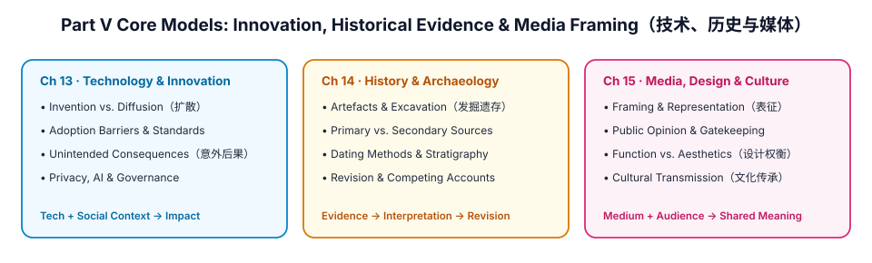

## Technology as Extended Human Ability（技术作为人的能力外部化）

Technology（技术）is the application of knowledge to create tools（工具）, systems（系统）, and processes（过程）that extend human ability beyond its biological limits（生物学极限）. A hammer extends the force of a human arm. A telescope（望远镜）extends vision across vast distances. A book extends memory（记忆）by storing information outside the brain. A car extends mobility（移动能力）beyond walking speed and endurance. The internet extends communication（通信）across time and space, connecting billions of people simultaneously. Every technology, from the simplest stone tool（最简单的石器）to the most complex artificial intelligence system（最复杂的人工智能系统）, exists because it allows humans to do something they could not do — or could not do as effectively — with their unaided bodies and minds.

Throughout human history, technology has expanded what people can do in ways that have transformed civilisation. Writing（文字）allowed knowledge to be stored and transmitted across generations without relying on oral tradition（口述传统）. The printing press（印刷机）made knowledge available beyond a privileged few, enabling mass literacy（大众识字）and the spread of ideas across continents. The steam engine（蒸汽机）multiplied the power available for work, launching the industrial revolution（工业革命）. Electricity（电力）transformed manufacturing, lighting, communication, and domestic life. Each major technological advance has expanded human capability in fundamental ways, creating new possibilities for production, communication, transportation, healthcare, and social organisation.

Technology enables entirely new activities alongside faster or more efficient versions of existing ones. The telephone（电话）created new forms of social and business relationships that did not exist when communication required physical proximity（物理接近）. The internet created new ways of working（远程工作）, learning（在线学习）, shopping（网上购物）, socialising（社交）, and creating that have no precedent in pre-digital society. The most transformative technologies（最具变革性的技术）change not merely how existing tasks are performed but what can be done at all — they create new categories of activity（新的活动类别）, new industries（新产业）, new social practices（新的社会实践）, and new forms of human experience.

Technology can also reduce certain human capabilities through disuse（因不使用而退化）. Reliance on GPS navigation（GPS导航依赖）may weaken spatial memory（空间记忆）and natural sense of direction（方向感）. Dependence on calculators（计算器依赖）may reduce mental arithmetic skills（心算能力）. Automated spell-checking（自动拼写检查）may reduce attention to spelling（拼写注意力）. Every technology that extends one type of ability may allow another to atrophy（萎缩）, and the net effect（净效应）depends on the context of use, the availability of alternatives, and whether the extended capability compensates for the diminished one. This trade-off（权衡）is inherent in all tool use — the tool extends what humans can do while potentially reducing the skills that the tool replaces.

Technology therefore functions as the mechanism through which tools extend human ability, change production, reshape communication, create new risks, and transform society across multiple dimensions. The vocabulary of technology — technology, tool, extended ability, biological limit, transformative technology, trade-off — names the processes through which technology expands human capability and the conditions that determine whether that expansion produces net benefits or creates new vulnerabilities. Technology texts use this vocabulary to trace the pathways from technological innovation through capability extension to the social outcomes that determine whether technology serves human flourishing or creates new forms of dependence and disempowerment.

## Invention, Application, and Diffusion（发明、应用与扩散）

Technological change proceeds through three interconnected stages: invention（发明）, application（应用）, and diffusion（扩散）. Each stage involves different processes, different actors, and different challenges, and the progression from one stage to the next is neither automatic nor guaranteed.

Invention is the creation of a new technology — a novel device（新设备）, process, or method that did not previously exist. Inventions can emerge from systematic scientific research（系统科学研究）, from practical problem-solving（实际问题解决）by engineers and craftspeople（工匠）, from accidental discovery（偶然发现）, or from the recombination of existing technologies in new ways（以新方式重组现有技术）. The telephone resulted from systematic research into sound transmission（声音传输研究）. Penicillin（青霉素）was discovered accidentally when Alexander Fleming noticed that a mould contaminant（霉菌污染物）had killed bacteria in a discarded culture dish. The internet emerged from the combination of existing computing（计算）and telecommunications（电信）technologies, connected through new protocols（新协议）for data exchange（数据交换）. Invention requires creativity（创造力）, technical knowledge（技术知识）, and often substantial resources for research and development（研发资源）.

Application is the process of turning an invention into a practical, reliable, and economically viable product or process（实用、可靠且经济可行的产品或过程）. Many inventions never reach the application stage because they are too expensive to manufacture（制造成本过高）, too unreliable for practical use（实际使用不可靠）, or insufficiently useful to justify the investment required for development. An innovation（创新）is an invention that has been successfully applied and adopted — it has moved from the laboratory or workshop（实验室或车间）into actual use by individuals, organisations, or societies. The gap between invention and innovation can be large: the basic principles of photography（摄影的基本原理）were known in the early 1800s, but practical cameras took decades to develop, and widespread consumer adoption took even longer.

Diffusion is the spread of a technology through a population（技术在人群中的传播）— from early adopters（早期采用者）to the mainstream（主流）and eventually to laggards（落后者）. Diffusion typically follows an S-curve（S形曲线）: slow initial adoption as the technology is expensive, unreliable, or unfamiliar; rapid growth as the technology improves, costs decline, and social acceptance increases; and eventual slowing as the market approaches saturation（市场接近饱和）. The speed of diffusion depends on several factors: the technology's relative advantage（相对优势）over existing alternatives, its compatibility（兼容性）with existing systems and practices, its complexity（复杂性）— how difficult it is to learn and use, its trialability（可试用性）— whether people can try it before committing, and its observability（可观察性）— whether its benefits are visible to potential adopters.

The time from invention to widespread diffusion has shortened dramatically over history. The printing press took approximately 100 years to spread across Europe. The telephone took about 50 years to reach widespread adoption in the United States. The internet reached one billion users（十亿用户）in approximately 15 years. Smartphones（智能手机）achieved global penetration（全球渗透）in less than a decade. This acceleration（加速）reflects improvements in manufacturing capacity（制造能力）, global communication（全球通信）, distribution networks（分销网络）, and the increasing interconnectedness of global markets.

Invention, application, and diffusion therefore represent the mechanism through which new technologies move from laboratory discoveries to widespread social use. The vocabulary of technological change — invention, application, diffusion, innovation, S-curve, early adopter, relative advantage, compatibility — names the stages through which technologies develop and the factors that determine whether they achieve widespread adoption or remain confined to niche applications. Technology texts use this vocabulary to trace the pathways from scientific discovery through technological development to the diffusion outcomes that determine whether new technologies transform society or remain marginal.

## Automation and Productivity（自动化与生产率）

Automation（自动化）is the use of technology to perform tasks with minimal human intervention（最少的人类干预）. Early automation replaced human muscle power（人力）with machine power（机器动力）— mechanical looms（机械织布机）automated weaving（织布）, assembly lines（装配线）automated manufacturing, and tractors（拖拉机）automated ploughing（犁地）. Modern automation extends beyond physical tasks to replace human cognitive work（认知工作）with computer-controlled systems — software automates data processing（数据处理）, algorithms automate decision-making（决策）, and artificial intelligence automates pattern recognition（模式识别）, language processing（语言处理）, and complex analysis（复杂分析）.

Automation increases productivity（生产率）by allowing more output to be produced with less labour input（更少的劳动投入）. A factory with automated assembly lines can produce far more goods per worker-hour（每工人小时）than one where everything is done manually. An office with automated data processing can handle far more transactions per employee than one where calculations are performed by hand. A warehouse（仓库）with robotic picking systems（机器人拣选系统）can process orders faster and more accurately than one relying on human workers. This productivity gain（生产率提升）is the primary economic driver（主要经济驱动力）of automation — it reduces production costs（生产成本）, lowers prices for consumers, and increases the total output available to society.

The relationship between automation and employment（就业）is complex and operates through multiple channels simultaneously. Automation eliminates some jobs by replacing the workers who performed them. It creates new jobs（创造新工作）in designing, building, maintaining, programming, and managing automated systems. It changes the nature of existing jobs（改变现有工作的性质）by automating some tasks within an occupation while leaving others that require human judgement, creativity, empathy, or complex physical dexterity. Historically, automation has not caused permanent mass unemployment（永久性大规模失业）— workers displaced from automated industries have found employment in new industries, new occupations, and expanded service sectors（扩展的服务业）. This historical pattern（历史模式）may not continue indefinitely, particularly if artificial intelligence automates cognitive tasks（认知任务）at a scale and speed that outpaces（超过）the creation of new employment opportunities.

Automation affects the distribution of income（收入分配）by changing which skills are valued and which are replaceable. Workers whose skills are complemented by automation（与自动化互补的技能）— who can work effectively with new technologies, interpret their outputs, and perform the non-automatable components of their roles — tend to benefit from higher wages（更高工资）and greater demand. Workers whose skills are replaced by automation（被自动化替代的技能）may face lower wages, unemployment, or the need to retrain for different occupations. This differential impact（差异性影响）contributes to growing wage inequality（工资不平等加剧）in many countries, as the premium for high-skilled workers（高技能工人的溢价）rises while wages for routine and manual occupations stagnate or decline.

Automation therefore represents the mechanism through which technology transfers repetitive tasks from humans to machines and how this transfer raises productivity, reduces labour costs, changes skill demand, and reshapes the labour market. The vocabulary of automation — automation, productivity, cognitive work, productivity gain, employment, wage inequality — names the processes through which automation transforms work and the conditions that determine whether automation produces broad-based prosperity or concentrated gains and widespread displacement. Technology texts use this vocabulary to trace the pathways from technological capability through task automation to the employment outcomes that determine which workers benefit from automation and which workers face displacement.

::: {.content-visible when-format="html"}

:::

## Artificial Intelligence and Decision Systems（人工智能与决策系统）

Artificial intelligence（人工智能 / AI）refers to computer systems that can perform tasks normally requiring human intelligence: visual perception（视觉感知）, speech recognition（语音识别）, natural language understanding（自然语言理解）, decision-making（决策）, pattern recognition（模式识别）, and learning from experience（从经验中学习）. AI systems do not possess consciousness（意识）, subjective understanding（主观理解）, or emotions（情感）, but they can perform specific cognitive tasks at or above human level within defined domains（在特定领域内）.

Machine learning（机器学习）is a subset of AI in which systems learn patterns from data rather than being explicitly programmed with rules（明确编程的规则）. A machine learning system is trained on large datasets（大型数据集）and learns to recognise patterns, make predictions（预测）, classify inputs（分类输入）, or generate outputs（生成输出）based on statistical relationships（统计关系）discovered in the training data. Deep learning（深度学习）— a form of machine learning using artificial neural networks（人工神经网络）with many layers — has achieved remarkable performance in image recognition（图像识别）, language translation（语言翻译）, speech recognition, game playing（博弈）, and generative tasks（生成任务）such as creating text, images, and code.

AI decision systems（AI决策系统）are deployed across many domains of social and economic life. Credit scoring systems（信用评分系统）use AI to evaluate loan applications（贷款申请）and determine who receives credit（信贷）. Hiring systems（招聘系统）screen job applications（筛选求职申请）and rank candidates（排名候选人）. Medical diagnosis systems（医学诊断系统）analyse medical images（医学影像）— X-rays（X光）, CT scans（CT扫描）, pathology slides（病理切片）— and suggest diagnoses. Criminal justice systems（刑事司法系统）use AI to assess the risk that a defendant will reoffend（再次犯罪）, influencing bail（保释）and sentencing（量刑）decisions. Educational systems use AI to personalise learning（个性化学习）, grade assignments（评分作业）, and predict student outcomes（预测学生结果）.

AI decision systems raise important concerns about bias（偏见）, fairness（公平）, transparency（透明度）, and accountability（问责）. If the data used to train an AI system contains historical biases（历史偏见）— for example, if historical hiring data reflects past discrimination（过去的歧视）against women or minority groups（少数群体）— the AI system may learn and perpetuate（延续）those biases, producing discriminatory outcomes（歧视性结果）at scale and with the appearance of objectivity（客观性的表象）. Many AI systems operate as "black boxes"（黑箱）where even their creators cannot fully explain how a particular decision was reached — the internal logic（内部逻辑）of deep neural networks（深度神经网络）is often opaque（不透明的）to human inspection. This lack of transparency raises questions about accountability: when an AI system makes a harmful decision, who is responsible — the developer（开发者）, the deployer（部署者）, the user（使用者）, or the system itself?

The development of AI also raises questions about privacy（隐私）, as many AI systems require large amounts of personal data（个人数据）to function effectively — training facial recognition systems（面部识别系统）requires images of people's faces, training language models（语言模型）requires vast text corpora（大量文本语料库）that may include personal communications. The concentration of AI capability（AI能力的集中）in a small number of technology companies（少数科技公司）and governments raises concerns about power（权力）, surveillance（监控）, and the democratic accountability（民主问责）of systems that increasingly shape public life.

Artificial intelligence and decision systems therefore represent the mechanism through which computer systems perform tasks normally requiring human intelligence and how those systems raise questions about bias, fairness, transparency, and accountability. The vocabulary of AI — artificial intelligence, machine learning, deep learning, neural network, AI decision system, bias, fairness, transparency, accountability, black box — names the technologies that enable machine intelligence and the ethical challenges that arise when those technologies make decisions that affect human lives. Technology texts use this vocabulary to trace the pathways from AI capability through deployment to the social outcomes that determine whether AI systems serve human wellbeing or perpetuate discrimination and undermine democratic values.

## Privacy, Data, and Digital Life（隐私、数据与数字生活）

Privacy（隐私）refers to the right of individuals to control access to their personal information（个人信息）, to decide what is shared and with whom, and to be free from unwanted observation（不受欢迎的监视）or intrusion（侵入）. In the digital age（数字时代）, privacy has become a major concern because unprecedented amounts of personal information are collected, stored, analysed, and shared by companies, governments, and other organisations — often without the individual's full knowledge or meaningful consent（有意义的同意）.

Digital technologies generate enormous amounts of data（大量数据）about individuals through both explicit and implicit collection. Explicit data collection（显式数据收集）occurs when people provide information directly — filling out forms（填写表格）, creating accounts（创建账户）, making purchases（进行购买）, or posting on social media（在社交媒体上发帖）. Implicit data collection（隐式数据收集）occurs through behavioural tracking（行为追踪）— recording which websites a person visits（访问哪些网站）, how long they spend on each page（在每个页面停留多长时间）, what they search for（搜索什么）, where they go (location data / 位置数据), what they purchase, and who they communicate with. This behavioural data（行为数据）is aggregated（聚合）, analysed, and used to build detailed profiles（详细画像）of individuals — their interests, habits, preferences, political views（政治观点）, health conditions, and social relationships.

The trade-off between privacy and convenience（隐私与便利之间的权衡）is a central tension of digital life. Personalised recommendations（个性化推荐）, convenient services（便捷服务）, targeted content（定向内容）, and free platforms funded by advertising（广告资助的免费平台）all depend on data collection. Many people express concern about data collection in surveys（在调查中表示担忧）but continue to use data-intensive services（数据密集型服务）because the immediate benefits are tangible（切实的）while the privacy costs are abstract（抽象的）and delayed. This "privacy paradox"（隐私悖论）reflects the difficulty of making informed choices（知情选择）when the consequences of data sharing（数据共享的后果）are complex, uncertain, and difficult to evaluate.

Governments have responded to privacy concerns with regulations（法规）that establish legal frameworks（法律框架）for data protection（数据保护）. The European Union's General Data Protection Regulation（欧盟通用数据保护条例 / GDPR）gives individuals rights over their personal data — the right to access（访问权）, correct（更正权）, delete（删除权）, and port（可携带权）their data — and requires companies to obtain explicit consent for data collection, to be transparent about how data is used, and to implement appropriate security measures（安全措施）. Similar regulations have been adopted or proposed in many other jurisdictions（司法管辖区）. The effectiveness of these regulations depends on enforcement（执行）, on the ability of regulators（监管机构）to keep pace with technological change, and on international cooperation（国际合作）in a digital economy where data flows across borders（数据跨境流动）.

Privacy, data, and digital life therefore represent the mechanism through which digital technologies collect personal information and how that collection creates tensions between privacy and convenience. The vocabulary of digital privacy — privacy, data collection, behavioural tracking, privacy paradox, data protection, General Data Protection Regulation — names the processes through which personal information is collected and the regulatory frameworks that attempt to protect individual privacy in a data-driven economy. Technology texts use this vocabulary to trace the pathways from data collection through privacy trade-offs to the regulatory outcomes that determine whether individuals can control their personal information or whether data collection proceeds without meaningful consent or oversight.

## Ethical Concerns and Social Impact（伦理问题与社会影响）

New technologies often raise ethical concerns（伦理问题）because they create new possibilities（新的可能性）that existing moral frameworks（现有道德框架）, laws（法律）, and social norms（社会规范）were not designed to handle. Nuclear technology（核技术）raised questions about creating weapons that could destroy humanity. Genetic engineering（基因工程）raises questions about modifying the genes of future generations（修改后代的基因）without their consent. Surveillance technology（监控技术）raises questions about the balance between security（安全）and privacy. Each new wave of technology requires societies to develop new ethical principles（新的伦理原则）, regulatory frameworks（监管框架）, and social agreements（社会协议）to govern its use.

Social media platforms（社交媒体平台）raise ethical questions about their role in spreading misinformation（传播虚假信息）, polarising public opinion（极化公众意见）, affecting mental health（影响心理健康）, and influencing democratic processes（影响民主过程）. Algorithms（算法）that determine what content users see are designed to maximise engagement（最大化参与度）, which can promote sensational（耸人听闻的）, emotionally provocative（情感挑衅性的）, or misleading content（误导性内容）over accurate, balanced, or nuanced information. These algorithmic systems（算法系统）can create echo chambers（信息茧房 / 回音室）where people are exposed primarily to information that confirms their existing beliefs, reinforcing polarisation（强化极化）and making constructive dialogue（建设性对话）across different viewpoints more difficult.

Artificial intelligence raises ethical questions about bias（偏见）, fairness（公平）, accountability（问责）, and the future of work（工作的未来）. When an AI system makes a decision that harms someone — denying a loan（拒绝贷款）, recommending an inappropriate medical treatment（推荐不当的医疗方案）, or identifying an innocent person as a criminal suspect（将无辜者识别为犯罪嫌疑人）— responsibility must be assigned among the developers, the organisations that deployed the system, and the system itself. Autonomous vehicles（自动驾驶汽车）raise ethical questions about programming decisions in unavoidable accident situations（不可避免的交通事故情境）— how should the vehicle's algorithm prioritise the safety of its passengers versus the safety of pedestrians（行人）or other road users?

Addressing the ethical concerns of technology requires input from multiple perspectives（多个视角）— not only from technologists（技术人员）who design the systems but also from ethicists（伦理学家）, policymakers（政策制定者）, affected communities（受影响的社区）, and the broader public（更广泛的公众）. Design choices（设计选择）reflect values and assumptions（价值观和假设）about what matters, who benefits, who bears risks, and what trade-offs are acceptable. Making these choices transparent（使这些选择透明化）and subject to democratic deliberation（民主审议）is essential for ensuring that technology serves human wellbeing rather than undermining it.

Ethical concerns and social impact therefore represent the mechanism through which new technologies create possibilities that existing moral frameworks were not designed to handle and how societies attempt to develop new ethical principles and regulatory frameworks to govern technological use. The vocabulary of technology ethics — ethical concern, misinformation, echo chamber, bias, fairness, accountability, democratic deliberation — names the challenges that arise when technologies create new possibilities and the processes through which societies attempt to ensure that technology serves human wellbeing. Technology texts use this vocabulary to trace the pathways from technological innovation through ethical challenge to the regulatory outcomes that determine whether technologies serve human flourishing or create new forms of harm.

## Unintended Consequences and Long-Term Change（意外后果与长期变化）

Technological change often produces unintended consequences（意外后果）— effects that were not anticipated by the creators or early adopters of the technology. These unintended effects can be positive, negative, or both, and they can be more significant than the intended effects. The difficulty of predicting consequences arises because technologies are introduced into complex social systems（复杂社会系统）where they interact with existing institutions（现有制度）, behaviours, economic structures, and cultural practices in ways that cannot be fully foreseen（无法完全预见）.

The internet was designed to share information among researchers and military institutions（研究人员和军事机构）. Its unintended consequences include the transformation of global commerce（全球商业变革）, the rise of social media（社交媒体的兴起）, the spread of misinformation（虚假信息传播）, new forms of political mobilisation（新型政治动员）, the gig economy（零工经济）, remote work（远程工作）, and the erosion of privacy（隐私侵蚀）. None of these effects were part of the original design, but they have reshaped society profoundly and created new challenges that the technology's creators could not have imagined.

Social media platforms were designed to connect people and share personal experiences. Their unintended consequences include documented effects on adolescent mental health（青少年心理健康）— increased anxiety（焦虑增加）, depression（抑郁）, and body image dissatisfaction（身体形象不满）— political polarisation（政治极化）through algorithmic amplification（算法放大）of divisive content（分裂性内容）, the rapid spread of conspiracy theories（阴谋论）and misinformation, and the erosion of shared factual foundations（共同事实基础的侵蚀）that democratic deliberation depends on. These consequences were not anticipated by the platforms' founders and have proven resistant to simple solutions（难以简单解决）.

Long-term social change from technology is inherently difficult to predict because it depends on how technologies interact with each other, with social institutions, and with human behaviour over decades or centuries. When the printing press was invented, nobody could have predicted the Protestant Reformation（新教改革）, the rise of modern science（现代科学的兴起）, or the spread of democratic ideas（民主思想的传播）. When the automobile was invented, nobody predicted that it would reshape cities into sprawling suburbs（蔓延的郊区）, create highway systems（公路系统）, contribute to climate change（导致气候变化）, or transform social relationships through increased individual mobility（个人流动性增加）.

The difficulty of predicting long-term consequences suggests that technological development should be accompanied by ongoing monitoring（持续监测）, adaptive regulation（适应性监管）that can respond to emerging effects, and institutional capacity（制度能力）to address problems as they arise rather than attempting to prevent all negative consequences in advance. The precautionary principle（预防原则）— that technologies with potentially serious or irreversible harms should be restricted until their safety is demonstrated — offers one approach to managing uncertainty, though it can also slow beneficial innovation. The challenge is to foster technological progress（促进技术进步）while maintaining the social, ethical, and regulatory frameworks（社会、伦理和监管框架）that ensure technology serves human wellbeing and democratic values（民主价值观）.

Unintended consequences and long-term change therefore represent the mechanism through which technological development produces effects that were not anticipated by the technology's creators and how societies attempt to manage those effects through ongoing monitoring and adaptive regulation. The vocabulary of technological change — unintended consequence, long-term change, complex social system, precautionary principle, adaptive regulation — names the challenges that arise when technologies interact with social systems and the processes through which societies attempt to manage those challenges. Technology texts use this vocabulary to trace the pathways from technological innovation through unintended consequence to the social outcomes that determine whether technologies serve human flourishing or create new forms of harm that societies must address through regulatory intervention.

::: {.content-visible when-format="html"}

:::

