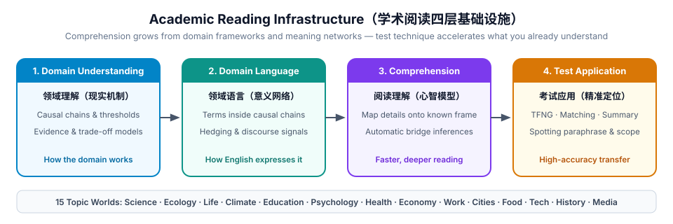

# Preface {.unnumbered}

This book is a domain-language reader（领域语言读本）for learners who want to understand the common topic worlds of IELTS Reading — science, environment, life, climate, education, psychology, health, economy, work, cities, agriculture, technology, history, media, design, and culture.

Each chapter opens one domain world（领域世界）and explains how that domain works, what problems it studies, how different factors interact, and how English expresses those facts, mechanisms, changes, risks, evidence, and debates. The main body is written in English. Chinese appears inside brackets after important concepts, mechanisms, and terms — supporting understanding without replacing English reading.

The book builds four layers:

1.  **Domain Understanding**（领域理解）— how the domain organises reality
2.  **Domain Language**（领域语言）— how English expresses that organisation
3.  **Reading Comprehension**（阅读理解）— how domain knowledge improves reading
4.  **Test Application**（考试应用）— how these skills transfer to test performance

The first two layers form the main content of this book. The third and fourth layers grow naturally from them and can be developed further through practice exercises, a workbook, or a companion volume.

The writing follows a simple principle: reading grows from understanding how a domain talks about the world. When the domain is understood, the reader can focus on what the text says rather than struggling to understand what the text is about. When the language is familiar, the reader can follow arguments through their full causal chains without pausing to decode individual terms.

This book is designed for learners at the intermediate level and above who are preparing for IELTS Reading or who want to read academic English more effectively. It can be read chapter by chapter, or readers can select the domains most relevant to their interests and needs.

Lin.Mi June 2026
